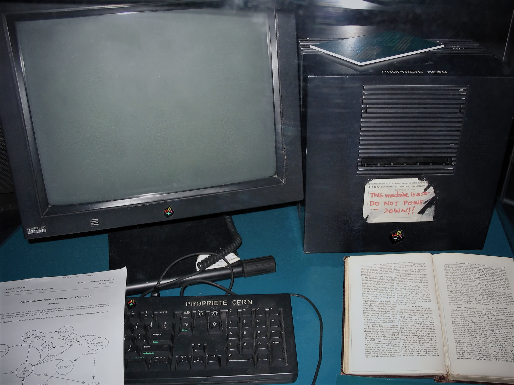
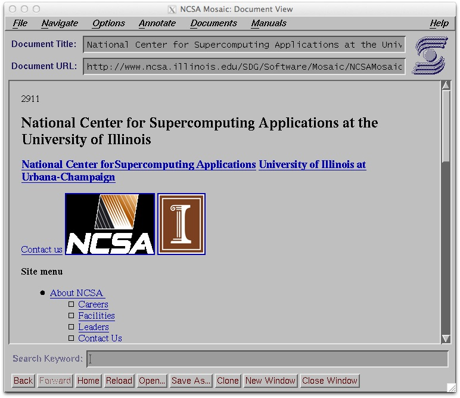
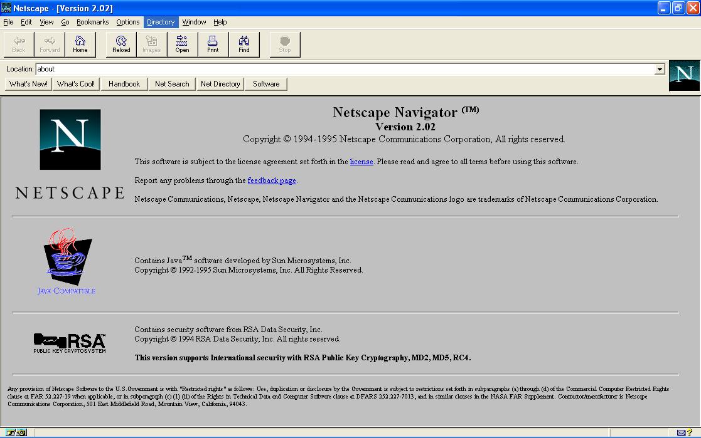
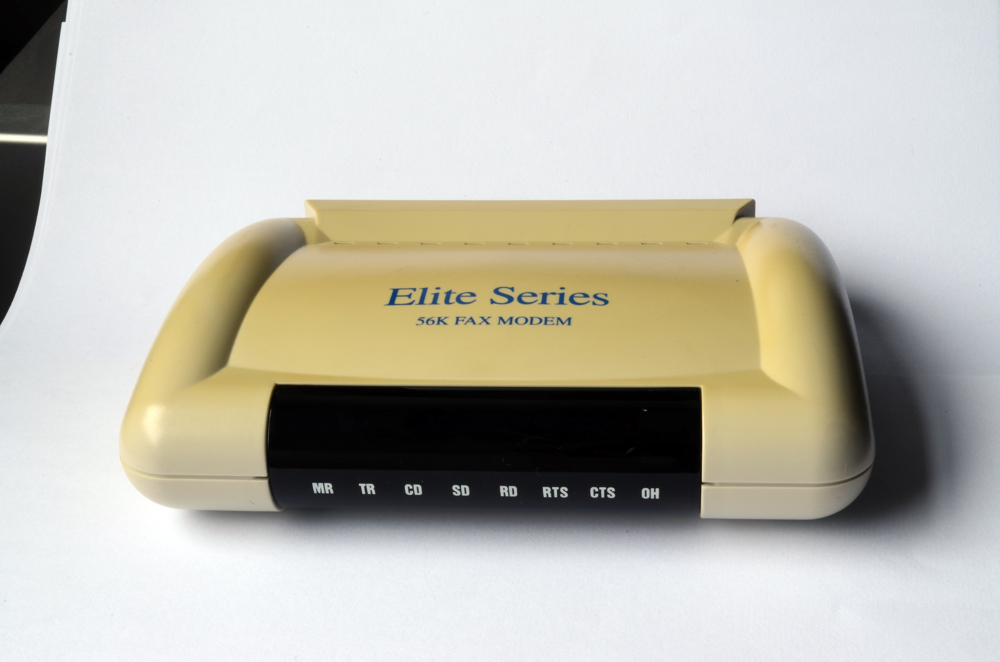

<!-- _class: title-slide -->
<!-- _backgroundColor: #091e3a -->
<!-- _color: #ffffff -->
<!-- _paginate: false -->
<!-- _header: "" -->
<!-- _footer: "" -->

Redes de Computadores • Atividade em Grupo

# A Revolução da Internet na Década de 1990
### Da rede acadêmica restrita à teia mundial de computadores: linha do tempo, marcos tecnológicos, personagens históricos e o legado na sociedade moderna

  <strong>Período Histórico:</strong> Anos 1990 &nbsp;|&nbsp; <strong>Foco:</strong> World Wide Web, Protocolos, Navegadores e Comercialização

---

<!-- _header: "Sumário • Estrutura da Apresentação" -->
<!-- _footer: "Redes de Computadores • Década de 1990" -->

## Sumário da Apresentação

  <h4>1. O Cenário Inicial e a Transição</h4>
  
O encerramento da ARPANET, a NSFNET e as limitações do modelo puramente acadêmico.

  <h4>2. Linha do Tempo Cronológica (1990-1999)</h4>
  
Ano a ano: do primeiro servidor Web à consolidação global e ao auge das pontocom.

  <h4>3. Principais Invenções e Marcos</h4>
  
A Tríade da Web (HTTP, HTML, URL), navegadores gráficos, JavaScript, SSL e conexão discada.

  <h4>4. Personagens Importantes</h4>
  
Tim Berners-Lee, Marc Andreessen, Brendan Eich, Linus Torvalds, Larry Page e Sergey Brin.

  <h4>5. Abertura Comercial e Provedores</h4>
  
Desativação da NSFNET, nascimento dos ISPs comerciais, Webmail e portais de conteúdo.

  <h4>6. Impacto na Internet Atual</h4>
  
Como os padrões, protocolos e serviços concebidos nos anos 90 sustentam o mundo hoje.

---

<!-- _header: "Contextualização Histórica" -->
<!-- _footer: "Redes de Computadores • Década de 1990" -->

## O Cenário no Início dos Anos 1990

### A Internet antes da Web:
- **1990: Encerramento da ARPANET**: A precursora militar e de pesquisa foi oficialmente desativada, passando o controle do backbone para a **NSFNET** (*National Science Foundation Network*).
- **Rede Exclusiva e Restrita**: Uso governamental, acadêmico e de defesa. O uso comercial era explicitamente **proibido** pelas políticas de uso aceitável (AUP).
- **Interface Baseada em Texto**: Usuários precisavam dominar terminais de linha de comando Unix e utilitários técnicos como **FTP, Telnet, Usenet, Archie** e **Gopher**.
- **A Barreira de Acesso**: Inexistência de multimídia integrada; o hipertexto ainda não era universal.

  <h4>O Ponto de Virada</h4>
  
A internet já possuía a infraestrutura física e os protocolos de transporte (<strong>TCP/IP</strong>), mas faltava uma <strong>camada de aplicação amigável</strong> que permitisse a qualquer ser humano navegar e compartilhar conhecimentos sem treinamento prévio.

  <strong>Conceito Chave de Redes:</strong> 
  A <strong>Internet</strong> é a rede física mundial interconectada por roteadores e protocolos IP. 
  A <strong>Web (WWW)</strong> é um sistema de aplicação que roda sobre a Internet!

---

<!-- _header: "Linha do Tempo (1990 - 1994) • Fundação da Web" -->
<!-- _footer: "Redes de Computadores • Década de 1990" -->

## Linha do Tempo: A Primeira Metade (1990 – 1994)

- 1990 **A Invenção da Web:** Tim Berners-Lee desenvolve no CERN os conceitos de **HTML, HTTP, URL** e o primeiro editor/navegador web chamado *WorldWideWeb*.
- 1991 **Abertura ao Público:** A WWW é disponibilizada publicamente. Linus Torvalds anuncia o kernel do **Linux**.
- 1992 **Expansão Global:** Primeiro servidor web instalado fora da Europa (no SLAC, EUA). Surge a expressão *"Surfar na Internet"*.
- 1993 **Revolução Gráfica (Mosaic):** Lançamento do navegador **NCSA Mosaic**, exibindo imagens embutidas junto ao texto. O CERN libera o código da Web para o domínio público.
- 1994 **Comércio e Padrões:** Fundação da **Netscape**; criação da **W3C** para padronização; surgem os diretórios Yahoo! e o navegador Opera.

  
  
O computador NeXTcube no CERN: o primeiro servidor web do planeta, com a etiqueta histórica: "Esta máquina é um servidor. NÃO DESLIGUE!!"

---

<!-- _header: "Linha do Tempo (1995 - 1999) • Explosão e Comercialização" -->
<!-- _footer: "Redes de Computadores • Década de 1990" -->

## Linha do Tempo: A Segunda Metade (1995 – 1999)

- 1995 **"O Ano da Internet":** Desativação do backbone NSFNET (plena abertura comercial); lançamento do **Windows 95** com *Internet Explorer 1.0*; criação do **JavaScript** e fundação de **Amazon** e **eBay**.
- 1996 **Comunicação em Massa:** Surge o **Hotmail** (webmail gratuito) e o **ICQ** (primeiro mensageiro instantâneo global); início da Guerra dos Navegadores.
- 1997 **Padrões Sem Fio:** Ratificação do padrão **IEEE 802.11 (Wi-Fi)**; registro do domínio `google.com`.
- 1998 **A Era das Buscas e Governança:** Fundação da **Google LLC** com o algoritmo *PageRank*; fundação da **ICANN** para administrar o DNS mundial.
- 1999 **P2P e Auge Ponto-Com:** Lançamento do **Napster** (compartilhamento descentralizado); pico da bolha especulativa da Internet e início do ADSL.

  <h4>Resumo da Transformação Decenal</h4>
  
Em 10 anos, a Internet passou de <strong>~300 mil máquinas</strong> estritamente acadêmicas em 1990 para mais de <strong>300 milhões de usuários</strong> e centenas de milhares de domínios comerciais em 1999.

  <ul style="font-size: 13px; margin-top: 8px;">
    <li><strong>1990:</strong> Sem sites públicos conhecidos.</li>
    <li><strong>1993:</strong> ~130 sites no mundo todo.</li>
    <li><strong>1996:</strong> Mais de 100 mil sites ativos.</li>
    <li><strong>1999:</strong> Mais de 3 milhões de sites registrados.</li>
  </ul>

---

<!-- _header: "Marco 1 • A Tríade da World Wide Web" -->
<!-- _footer: "Redes de Computadores • Década de 1990" -->

## Marco 1: A Tríade Tecnológica da World Wide Web

  <h4>1. HTML (Linguagem)</h4>
  
<strong>HyperText Markup Language:</strong>

  
Permitiu estruturar texto através de tags simples (títulos, parágrafos, listas) e incorporar <strong>hiperlinks</strong> clicáveis, conectando qualquer documento a outro em qualquer lugar da rede.

  

    Origem: SGML adaptado para a simplicidade da rede.
  

  <h4>2. HTTP (Protocolo)</h4>
  
<strong>HyperText Transfer Protocol:</strong>

  
Protocolo de camada de aplicação, simples e sem estado (<em>stateless</em>), baseado no modelo <strong>Requisição-Resposta</strong> sobre a porta TCP 80. Rápido, leve e extensível por cabeçalhos (headers).

  

    Métodos fundamentais: GET, POST e HEAD.
  

  <h4>3. URL / URI (Endereço)</h4>
  
<strong>Uniform Resource Locator:</strong>

  
Esquema de identificação global único no formato: 
  <code>protocolo://domínio:porta/caminho</code> 
  Permitiu que qualquer arquivo na rede mundial tivesse um identificador inequívoco.

  

    Ex: <code>http://info.cern.ch/hypertext/...</code>
  

  <h4>Por que foi genial?</h4>
  
Berners-Lee não inventou o conceito de hipertexto nem a infraestrutura de rede: <strong>sua genialidade foi unir o hipertexto à arquitetura TCP/IP e ao DNS</strong> em um sistema aberto, descentralizado e sem necessidade de autorização central para publicação.

---

<!-- _header: "Marco 2 • A Revolução dos Navegadores Gráficos" -->
<!-- _footer: "Redes de Computadores • Década de 1990" -->

## Marco 2: A Revolução dos Navegadores Gráficos

### NCSA Mosaic (1993)
- Criado por **Marc Andreessen** e **Eric Bina** no NCSA (Universidade de Illinois).
- **Inovação Absoluta:** O primeiro navegador a exibir imagens diretamente na página (``) ao lado de texto formatado.
- Disponível para Windows, Mac e Unix, tornando a navegação intuitiva com botões "Avançar", "Voltar" e "Favoritos".

### Netscape Navigator (1994)
- Criado pela *Netscape Communications*.
- Mais rápido, com carregamento progressivo de imagens.
- Introduziu tecnologias seminais: **Cookies** (sessão no HTTP) e suporte à criptografia **SSL**.

  
  
Tela original do NCSA Mosaic (1993): o pioneiro da navegação multimídia.

---

<!-- _header: "Marco 3 • Guerra dos Navegadores e Dinamismo" -->
<!-- _footer: "Redes de Computadores • Década de 1990" -->

## Marco 3: A Guerra dos Navegadores e o Dinamismo

  
  
Netscape Navigator: dominou mais de 80% do mercado em meados dos anos 90.

### A Guerra dos Navegadores:
- **Netscape vs. Microsoft Internet Explorer:**
  - A Microsoft percebeu a ameaça da Web e incluiu o IE gratuitamente embutido no Windows 95 OSR2 e Windows 98.
  - A disputa impulsionou a rápida adição de recursos ao HTML (tabelas, frames, fontes personalizadas) e a criação das **Folhas de Estilo em Cascata (CSS)** em 1996.

### O Nascimento do JavaScript (1995):
- Desenvolvido por **Brendan Eich** na Netscape em apenas 10 dias.
- Transformou a Web de páginas puramente estáticas em **interfaces interativas**: validações de formulário, animações e manipulação do DOM.

---

<!-- _header: "Marco 4 • Acesso Discado, ISPs e Criptografia" -->
<!-- _footer: "Redes de Computadores • Década de 1990" -->

## Marco 4: A Conexão Dial-Up e a Segurança (SSL)

### A Era da Conexão Discada (Dial-Up):
- Acesso através da infraestrutura de telefonia comutada (PSTN).
- Modems de **14.4 kbps, 28.8 kbps, 33.6 kbps** até o ápice de **56 kbps** (V.90).
- Sons marcantes do *handshake* de modulação analógica.
- Provedores de Acesso (**ISPs**): Nos EUA, AOL (*America Online*); no Brasil, surgem **UOL, Mandic e ZAZ/Terra** em 1996.
- Limitações: cobrança por pulsos telefônicos; internet acessada principalmente de madrugada e finais de semana.

### Criptografia SSL/TLS (1994):
- Criado pela Netscape: **porta TCP 443 (HTTPS)**.
- Viabilizou o envio confidencial de dados de cartões de crédito e senhas.

  
  
Modem analógico 56K: a porta de entrada da população para a Internet nos anos 90.

---

<!-- _header: "Marco 5 • Comunicação Instantânea e Busca Inteligente" -->
<!-- _footer: "Redes de Computadores • Década de 1990" -->

## Marco 5: Mensageria Instantânea e a Busca Google

### A Revolução da Comunicação Social:
- **ICQ (1996):** Criado pela empresa israelense Mirabilis. Introduziu o conceito de **lista de contatos online**, sons característicos (*"Uh-oh!"*) e identificação por número UIN.
- **mIRC (IRC) e Webmail (Hotmail 1996):** Democratizaram o e-mail em qualquer navegador, sem necessidade de configurar clientes POP3/SMTP locais.

### A Reinvenção dos Motores de Busca (1998):
- Os mecanismos antigos (Yahoo!, AltaVista, Lycos) eram diretórios manuais ou contavam palavras-chave puras (vulneráveis a spam).
- **Google & PageRank:** Larry Page e Sergey Brin modelaram a Web como um grafo gigante de nós. A relevância de uma página passou a depender da quantidade e qualidade de links apontados para ela.

  

    

      
      ICQ (1996)
    

    

      
    

  

  
Marcos de comunicação (ICQ) e busca na web (Google 1998).

---

<!-- _header: "Personagens Marcantes • Os Pioneiros da Década" -->
<!-- _footer: "Redes de Computadores • Década de 1990" -->

## Personagem 1: Sir Tim Berners-Lee

  
  
Sir Tim Berners-Lee: O Pai da World Wide Web.

### Papel Histórico e Realizações:
- Cientista da computação britânico, pesquisador do CERN (Genebra, Suíça).
- Escreveu em 1989 a histórica proposta *"Information Management: A Proposal"*, chamada por seu chefe de *"Vaga, mas empolgante"*.
- **O Criador Completo:** Desenvolveu o primeiro servidor HTTP, o primeiro navegador e editor gráfico de páginas e a especificação das URLs.

### A Decisão mais Nobre da História da Computação:
- Convenceu o conselho do CERN a **abrir mão de qualquer patente ou royalty** sobre a tecnologia da Web em abril de 1993.
- Fundou em 1994 o **W3C** (*World Wide Web Consortium*) no MIT para assegurar padrões livres e abertos.

---

<!-- _header: "Personagens Marcantes • Empreendedores e Visionários" -->
<!-- _footer: "Redes de Computadores • Década de 1990" -->

## Personagem 2: Marc Andreessen & Brendan Eich

  

    
  

  <h4>Marc Andreessen</h4>
  
<strong>Cofundador do Mosaic e da Netscape:</strong>

  <ul>
    <li>Criou aos 22 anos o software que transformou a web em mídia de massas.</li>
    <li>Com o IPO da Netscape em 1995, inaugurou a era do Vale do Silício moderno e venture capital.</li>
    <li>Fundou a <em>Andreessen Horowitz (a16z)</em>, um dos maiores fundos mundiais de tecnologia.</li>
  </ul>

  

    JS • JavaScript (1995)
  

  <h4>Brendan Eich</h4>
  
<strong>Criador da Linguagem JavaScript:</strong>

  <ul>
    <li>Contratado pela Netscape em 1995 para criar uma linguagem de script dinâmica para o navegador.</li>
    <li>Criou a versão inicial da linguagem em impressionantes <strong>10 dias</strong>.</li>
    <li>Cofundou a Fundação <strong>Mozilla</strong> (Firefox) e posteriormente o navegador <strong>Brave</strong>.</li>
    <li>Criou a tecnologia que hoje é a base de todo o frontend moderno no ecossistema web mundial.</li>
  </ul>

---

<!-- _header: "Personagens Marcantes • Infraestrutura e Algoritmos" -->
<!-- _footer: "Redes de Computadores • Década de 1990" -->

## Personagem 3: Linus Torvalds, Larry Page & Sergey Brin

  

    
  

  <h4>Linus Torvalds (Linux - 1991)</h4>
  <ul>
    <li>Estudante finlandês que publicou o kernel livre do Linux em 1991 na Usenet.</li>
    <li>A união do Linux com o servidor <strong>Apache HTTP Server (1995)</strong> formou o pilar da arquitetura <strong>LAMP</strong>, hospedando a imensa maioria dos servidores e sites do planeta.</li>
  </ul>

  

    Google • PageRank (1998)
  

  <h4>Larry Page & Sergey Brin</h4>
  <ul>
    <li>Doutorandos em Stanford que criaram o algoritmo revolucionário <strong>PageRank</strong>.</li>
    <li>Modelaram a web como um grafo de nós e hiperlinks, avaliando a reputação de páginas.</li>
    <li>Fundaram a Google em 1998, transformando a navegação na Web em uma experiência veloz, precisa e sem poluição visual.</li>
  </ul>

---

<!-- _header: "Impacto Atual • Infraestrutura, Protocolos e Redes" -->
<!-- _footer: "Redes de Computadores • Década de 1990" -->

## Como Esses Avanços Influenciam a Internet Atual (1/2)

  <h4>A Evolução Contínua do HTTP</h4>
  
O HTTP/1.0 (1996) e HTTP/1.1 (1999 - conexões persistentes <em>Keep-Alive</em>) são as raízes diretas do <strong>HTTP/2</strong> (multiplexação em stream binário) e do <strong>HTTP/3</strong> (executado sobre UDP via QUIC). Toda API REST e microserviço atual repousa nessa base.

  <h4>Segurança Nativa e Criptografia Ubíqua</h4>
  
O conceito de camadas seguras concebido no <strong>SSL</strong> da Netscape em 1994 evoluiu para o protocolo <strong>TLS 1.3</strong>. Hoje, mais de 95% do tráfego web global opera criptografado de ponta a ponta, viabilizando bancos digitais, Pix e comércio eletrônico.

  <h4>A Hegemonia do Linux na Nuvem</h4>
  
O kernel criado por Torvalds em 1991 sustenta <strong>mais de 90% dos servidores mundiais</strong>, incluindo os centros de dados de gigantes como AWS, Google Cloud, Microsoft Azure, servidores de borda (Edge) e contêineres Docker/Kubernetes.

  <h4>Padronização e Governança Global</h4>
  
A criação da <strong>W3C (1994)</strong> e da <strong>ICANN (1998)</strong> estabeleceu que nenhum país ou empresa proprietária tem o monopólio da Internet. O sistema de nomes de domínio (.br, .com) e as especificações da Web mantêm-se interoperáveis e universais.

---

<!-- _header: "Impacto Atual • Sociedade, Aplicações e Economia" -->
<!-- _footer: "Redes de Computadores • Década de 1990" -->

## Como Esses Avanços Influenciam a Internet Atual (2/2)

### Da Semente dos Anos 90 ao Mundo Atual:
- **Aplicações Web Modernas (SPAs):** O JavaScript criado em 1995 hoje impulsiona frameworks como *React, Angular, Vue* e plataformas de backend completas (*Node.js*).
- **Comércio Eletrônico Trilionário:** O modelo de negócios inaugurado pela Amazon e eBay em 1994/1995 consolidou a economia digital, marketplaces e serviços em nuvem.
- **Redes Sociais e Mensageria Instantânea:** A dinâmica social inaugurada pelo ICQ e pelas salas de bate-papo pavimentou os hábitos de comunicação que hoje movem *WhatsApp, Instagram, Telegram* e *Discord*.
- **Acesso Móvel e Sem Fio:** A especificação do Wi-Fi (802.11) em 1997 permitiu a emancipação de cabos e a subsequente explosão dos smartphones nos anos 2000.

  <h4>A Base para a Inteligência Artificial</h4>
  
A visão de Tim Berners-Lee de uma biblioteca global de conhecimento indexado e hiperconectado gerou os gigantescos corpora de dados (páginas, artigos, repositórios abertos) que tornaram possível o treinamento dos grandes modelos de linguagem (LLMs) que utilizamos hoje!

---

<!-- _header: "Conclusão • O Legado da Década de 1990" -->
<!-- _footer: "Redes de Computadores • Década de 1990" -->

## Conclusão: O Legado Indiscutível dos Anos 90

### A Década Decisiva:
- Os anos 90 representam a **transição de fase mais crítica** da história das comunicações humanas:
  1. A transição da rede experimental militar para o uso civil aberto.
  2. A criação da interface que democratizou a informação mundial (World Wide Web).
  3. A consolidação dos modelos de governança, padronização e software livre.

> *"A Web não conecta apenas computadores; ela conecta pessoas."*  
> — **Sir Tim Berners-Lee**

  <h4>Três Lições Eternas para Redes de Computadores:</h4>
  <ul>
    <li><strong>Padrões Abertos Vencem Tecnologias Fechadas:</strong> Protocolos livres e sem royalties superaram todos os ecossistemas proprietários corporativos da época.</li>
    <li><strong>Simplicidade Escala Globalmente:</strong> O HTTP e o HTML eram tecnicamente mais simples que projetos concorrentes (ex: Xanadu), e exatamente por isso conquistaram o mundo.</li>
    <li><strong>Descentralização é Resiliência:</strong> Uma rede onde qualquer um pode levantar um servidor sem autorização prévia é o alicerce da inovação contínua.</li>
  </ul>

---

<!-- _header: "Referências Bibliográficas" -->
<!-- _footer: "Redes de Computadores • Década de 1990" -->

## Referências Bibliográficas e Fontes Históricas

- **KUROSE, James F.; ROSS, Keith W.** *Redes de Computadores e a Internet: Uma Abordagem Top-Down*. 6ª e 7ª ed. São Paulo: Pearson, 2013/2017.
- **TANENBAUM, Andrew S.; WETHERALL, David.** *Redes de Computadores*. 5ª ed. São Paulo: Pearson Prentice Hall, 2011.
- **BERNERS-LEE, Tim; FISCHETTI, Mark.** *Weaving the Web: The Original Design and Ultimate Destiny of the World Wide Web*. HarperCollins, 1999.
- **CERN (European Organization for Nuclear Research).** *The Birth of the Web: History and Archives*. Disponível em: `<https://home.cern/science/computing/birth-web>`.

- **W3C (World Wide Web Consortium).** *A Little History of the World Wide Web*. W3C Historical Archive.
- **INTERNET SOCIETY (ISOC).** *Brief History of the Internet*. Disponível em: `<https://www.internetsociety.org/internet/history-internet/>`.
- **IETF RFCs Fundamentais:**
  - `RFC 1945` – Hypertext Transfer Protocol - HTTP/1.0 (1996).
  - `RFC 2616` – Hypertext Transfer Protocol - HTTP/1.1 (1999).
  - `RFC 2246` – The TLS Protocol Version 1.0 (1999).
- **ICANN.** *History of the Internet Corporation for Assigned Names and Numbers* (1998).

  Obrigado pela atenção! Espaço aberto para perguntas e debates.

