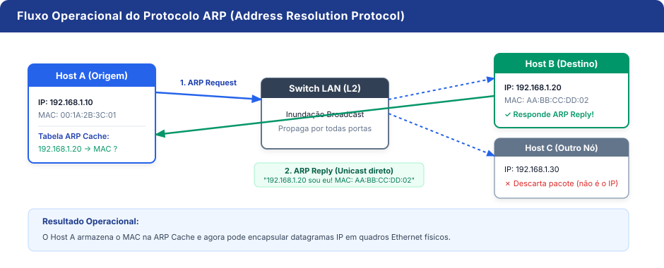
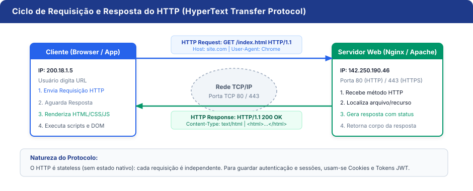
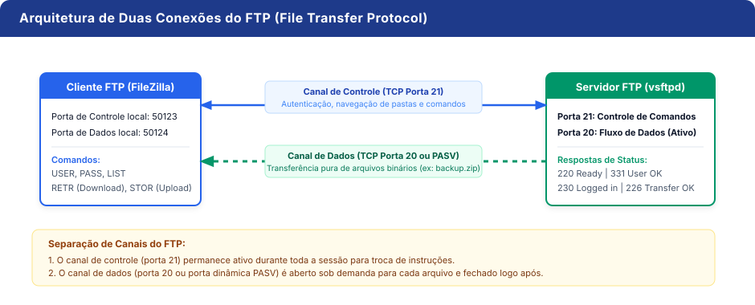
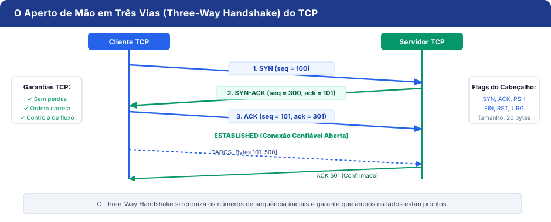
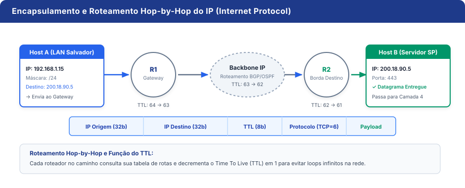
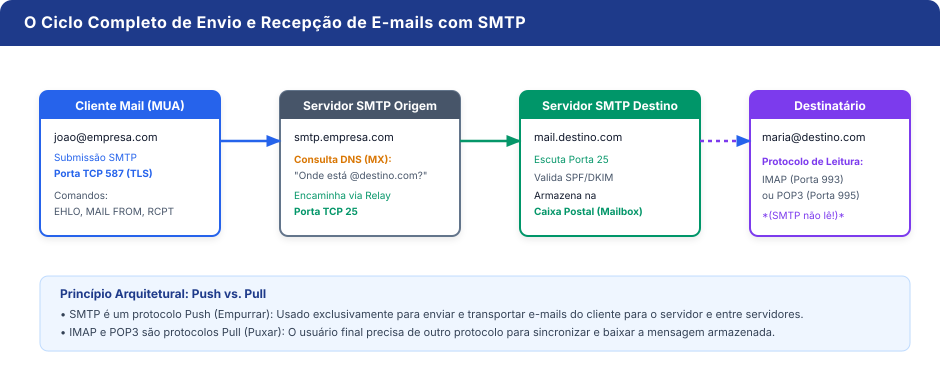
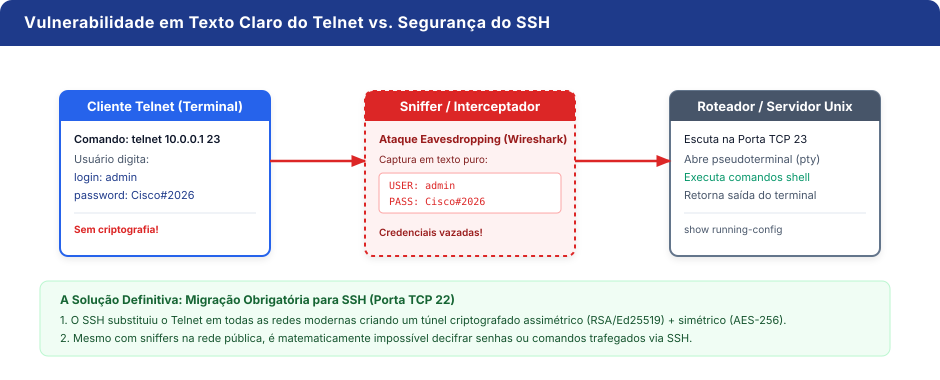
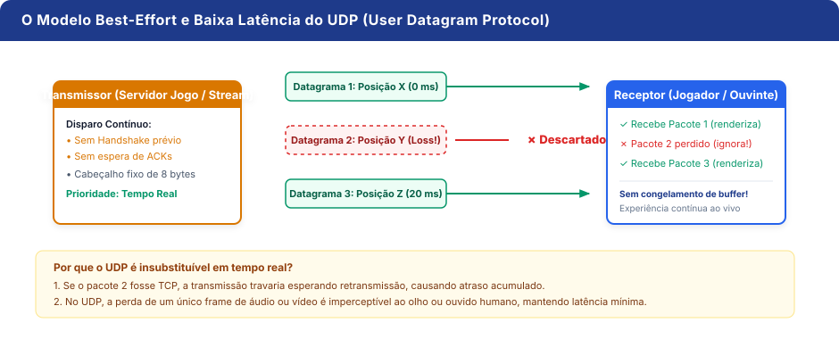
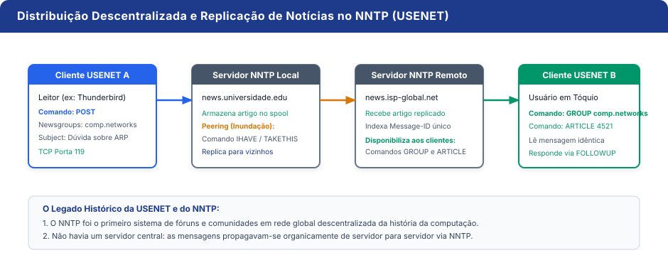

<!-- _class: title-slide -->
<!-- _backgroundColor: #091e3a -->
<!-- _color: #ffffff -->
<!-- _paginate: false -->
<!-- _header: "" -->
<!-- _footer: "" -->

<span class="tag">Redes de Computadores • Atividade em Grupo 2</span>

# Protocolos de Redes de Computadores
### Estudo comparativo, analogias do cotidiano, arquitetura de comunicação e relações funcionais entre os principais protocolos da Internet

<div class="title-footer">
  <strong>Protocolos Estudados:</strong> dARP/ARP • HTTP • FTP • TCP • ICMP • IP • SMTP • Telnet • UDP • NNTP
</div>

---

<!-- _header: "Sumário Executivo • Mapa de Protocolos" -->
<!-- _footer: "Redes de Computadores • Atividade 2" -->

## Mapa dos 10 Protocolos por Camada

<div class="grid-2-top">

<div class="card card-purple">
  <h4>Camada de Aplicação (OSI 7 / TCP-IP 4)</h4>
  <p>Protocolos de serviço direto ao usuário e sistemas:</p>
  <ul>
    <li><strong>HTTP:</strong> Navegação na Web e consumo de APIs REST</li>
    <li><strong>FTP:</strong> Transferência de arquivos bidirecional</li>
    <li><strong>SMTP:</strong> Envio e retransmissão de mensagens de e-mail</li>
    <li><strong>Telnet:</strong> Emulação de terminal remoto em texto claro</li>
    <li><strong>NNTP:</strong> Fóruns e grupos de discussão USENET</li>
  </ul>
</div>

<div class="card card-blue">
  <h4>Camadas de Transporte, Rede e Enlace</h4>
  <p>Protocolos de infraestrutura, roteamento e entrega:</p>
  <ul>
    <li><strong>TCP (Transporte):</strong> Entrega confiável com handshake e controle de fluxo</li>
    <li><strong>UDP (Transporte):</strong> Transmissão veloz e sem conexão para tempo real</li>
    <li><strong>IP (Rede):</strong> Endereçamento lógico hierárquico e roteamento global</li>
    <li><strong>ICMP (Rede):</strong> Diagnóstico, controle e teste de conectividade (Ping)</li>
    <li><strong>dARP / ARP (Enlace/Rede):</strong> Resolução de endereço IP para endereço físico MAC</li>
  </ul>
</div>

</div>

<div class="highlight" style="margin-top: 14px; text-align: center;">
  <strong>Estrutura da Análise:</strong> Cada protocolo conterá rigorosamente <strong>5 slides</strong>: 1. Identificação &bull; 2. Analogia do Cotidiano &bull; 3. Ilustração/Fluxograma &bull; 4. Exemplo Real &bull; 5. Relação com outros Protocolos.
</div>

---

<!-- _header: "1. dARP / ARP • Slide 1 de 5 — Identificação" -->
<!-- _footer: "Protocolo 1: dARP / ARP • Camada de Enlace / Inter-rede" -->

## 1. dARP / ARP: Identificação e Função Principal

<div class="grid-2">

<div>

### Ficha Técnica do Protocolo
- **Nome Oficial:** ARP (*Address Resolution Protocol*) / Dynamic ARP (dARP)
- **Sigla por Extenso:** Protocolo de Resolução de Endereços (Dinâmico)
- **Camada:** Enlace de Dados / Inter-rede (Camada 2 / 2.5)
- **RFC Padronizadora:** RFC 826
- **Escopo de Operação:** Rede Local (LAN / *Broadcast Domain*)

<div class="highlight">
  <span class="protocol-badge">FUNÇÃO PRINCIPAL</span><br>
  Descobrir e mapear dinamicamente o <strong>endereço físico (MAC Address de 48 bits)</strong> da placa de rede correspondente a um <strong>endereço lógico conhecido (IPv4 de 32 bits)</strong> dentro do mesmo domínio de difusão local.
</div>

</div>

<div>

<div class="card card-blue">
  <h4>Por que ele é indispensável?</h4>
  <p>Na camada de Rede (Camada 3), os roteadores e computadores conversam usando endereços IP lógicos (ex: <code>192.168.1.5</code>). Porém, placas de rede Ethernet e chips Wi-Fi <strong>não compreendem IP nativamente</strong>: elas só conseguem enviar e receber sinais elétricos ou de rádio endereçados a um MAC físico gravado no hardware (ex: <code>AA:BB:CC:11:22:33</code>).</p>
  <p style="margin-top: 8px;">O <strong>ARP</strong> é a engrenagem invisível que realiza essa conversão indispensável.</p>
</div>

</div>

</div>

---

<!-- _header: "1. dARP / ARP • Slide 2 de 5 — Analogia" -->
<!-- _footer: "Protocolo 1: dARP / ARP • Camada de Enlace / Inter-rede" -->

## 1. dARP / ARP: Analogia com o Cotidiano

<div class="analogy-box">
  <strong>Analogia:</strong> O entregador de encomendas chamando o nome de um morador no saguão de um condomínio.
</div>

<div class="grid-2-top">

<div class="card card-amber">
  <h4>A Situação no Mundo Real</h4>
  <ul>
    <li>Um entregador chega à recepção de um edifício com uma caixa etiquetada para <strong>"Carlos Souza"</strong> (o endereço lógico / IP).</li>
    <li>O entregador não conhece o rosto de Carlos nem sabe qual é o número do apartamento dele (o endereço físico / MAC).</li>
    <li>Ele grita em voz alta para todo o saguão: <em>"Quem aqui é Carlos Souza?"</em> (<strong>Broadcast ARP Request</strong>).</li>
    <li>Todos no saguão ouvem, mas quem não se chama Carlos ignora. O verdadeiro Carlos se aproxima e diz em particular: <em>"Sou eu! Estou no apto 302"</em> (<strong>Unicast ARP Reply</strong>).</li>
  </ul>
</div>

<div class="card card-blue">
  <h4>Por que essa analogia é perfeita?</h4>
  <ul>
    <li><strong>Broadcast de Pergunta:</strong> O Host de origem não sabe quem é o dono do MAC, então precisa incomodar todos na rede local enviando para o endereço de difusão (<code>FF:FF:FF:FF:FF:FF</code>).</li>
    <li><strong>Resposta Unicast:</strong> Apenas o dono legítimo do IP responde diretamente à origem.</li>
    <li><strong>Memória de Prancheta (Cache):</strong> O entregador anota o apartamento de Carlos em sua prancheta (<strong>Tabela ARP Cache</strong>) para que nas próximas entregas não precise gritar tudo de novo!</li>
  </ul>
</div>

</div>

---

<!-- _header: "1. dARP / ARP • Slide 3 de 5 — Ilustração" -->
<!-- _footer: "Protocolo 1: dARP / ARP • Camada de Enlace / Inter-rede" -->

## 1. dARP / ARP: Esquema Operacional

<div style="text-align: center;">
  
</div>

---

<!-- _header: "1. dARP / ARP • Slide 4 de 5 — Exemplo Real" -->
<!-- _footer: "Protocolo 1: dARP / ARP • Camada de Enlace / Inter-rede" -->

## 1. dARP / ARP: Exemplo Real de Aplicação

<div class="grid-2">

<div>

### Como Acontece no Seu Computador:
1. Você acabou de ligar seu notebook na rede Wi-Fi e digita `google.com`.
2. Seu computador sabe o IP do roteador (Gateway Padrão: `192.168.1.1`), mas **ainda não conhece o endereço MAC do roteador**.
3. Imediatamente, antes de enviar o primeiro pacote de dados, seu sistema operacional dispara um pacote **ARP Request** pela placa de rede.
4. O roteador Wi-Fi recebe o pedido e responde com seu MAC.
5. Seu notebook monta a conexão e armazena na memória volátil.

</div>

<div>

<div class="card card-emerald">
  <h4>Comando Real no Terminal</h4>
  <p>Abra o PowerShell ou Prompt de Comando e digite:</p>
  <pre style="margin: 6px 0; background: #0f172a; color: #38bdf8; padding: 10px; border-radius: 6px; font-size: 13px;"><code>> arp -a

Interface: 192.168.1.10 --- 0x14
  Endereço IP       Endereço Físico     Tipo
  192.168.1.1       00-50-56-c0-00-08   dinâmico
  192.168.1.255     ff-ff-ff-ff-ff-ff   estático</code></pre>
  <p style="font-size: 13px; color: #475569;">A flag <code>dinâmico</code> indica que o endereço foi aprendido via <strong>Dynamic ARP</strong> e expirará após alguns minutos se não for reutilizado.</p>
</div>

</div>

</div>

---

<!-- _header: "1. dARP / ARP • Slide 5 de 5 — Relação com Outros Protocolos" -->
<!-- _footer: "Protocolo 1: dARP / ARP • Camada de Enlace / Inter-rede" -->

## 1. dARP / ARP: Relação com Outros Protocolos

<div class="grid-2-top">

<div class="card card-blue">
  <h4>Relação com o IP (Internet Protocol)</h4>
  <ul>
    <li>O <strong>IP</strong> e o <strong>ARP</strong> operam em simbiose fundamental: o IP é o protocolo da camada 3 que define a lógica de roteamento fim-a-fim pelo mundo.</li>
    <li>Porém, o IP <strong>não tem capacidade física de colocar sinais nos cabos ou antenas</strong>. Quando um datagrama IP precisa ser enviado ao próximo salto (hop), o IP solicita ao ARP: <em>"Encontre o MAC associado a este próximo IP para que eu possa encapsular o quadro Ethernet"</em>.</li>
  </ul>
</div>

<div class="card card-emerald">
  <h4>Relação com Ethernet (IEEE 802.3) e DHCP</h4>
  <ul>
    <li><strong>Ethernet:</strong> O pacote ARP é colocado diretamente dentro de um quadro Ethernet (EtherType <code>0x0806</code>), dispensando cabeçalhos IP para funcionar.</li>
    <li><strong>DHCP:</strong> Quando o DHCP entrega um novo IP dinâmico para seu computador, o sistema usa o <strong>Gratuitous ARP</strong> (um ARP emitido para o próprio IP recém-adquirido) para checar se outra máquina na rede não está usando o mesmo IP por engano (detecção de conflito).</li>
  </ul>
</div>

</div>

---

<!-- _header: "2. HTTP • Slide 1 de 5 — Identificação" -->
<!-- _footer: "Protocolo 2: HTTP • Camada de Aplicação" -->

## 2. HTTP: Identificação e Função Principal

<div class="grid-2">

<div>

### Ficha Técnica do Protocolo
- **Nome Oficial:** HTTP (*HyperText Transfer Protocol*)
- **Sigla por Extenso:** Protocolo de Transferência de Hipertexto
- **Camada:** Aplicação (Camada 7 OSI / Camada 4 TCP/IP)
- **Porta Padrão:** Porta 80 (HTTP) e Porta 443 (HTTPS seguro com TLS)
- **RFC Padronizadora:** RFC 1945 (HTTP/1.0), RFC 2616 (HTTP/1.1), RFC 7540 (HTTP/2), RFC 9114 (HTTP/3)

<div class="highlight">
  <span class="protocol-badge">FUNÇÃO PRINCIPAL</span><br>
  Fornecer um protocolo padronizado, extensível e <strong>sem estado (stateless)</strong> para requisitar e transferir recursos hipermídia (documentos HTML, folhas de estilo CSS, scripts JavaScript, imagens, áudios e dados JSON de APIs) entre clientes e servidores web.
</div>

</div>

<div>

<div class="card card-blue">
  <h4>A Arquitetura Requisição-Resposta</h4>
  <p>O HTTP é fundamentado em verbos (métodos) semânticos:</p>
  <ul>
    <li><code>GET</code>: Solicita a recuperação de um recurso (página, imagem).</li>
    <li><code>POST</code>: Envia dados para processamento no servidor (formulários, logins).</li>
    <li><code>PUT / PATCH</code>: Atualiza recursos existentes no servidor.</li>
    <li><code>DELETE</code>: Remove recursos remotos.</li>
  </ul>
</div>

</div>

</div>

---

<!-- _header: "2. HTTP • Slide 2 de 5 — Analogia" -->
<!-- _footer: "Protocolo 2: HTTP • Camada de Aplicação" -->

## 2. HTTP: Analogia com o Cotidiano

<div class="analogy-box">
  <strong>Analogia:</strong> Fazer pedidos pontuais no balcão de uma lanchonete expressa.
</div>

<div class="grid-2-top">

<div class="card card-amber">
  <h4>A Situação no Mundo Real</h4>
  <ul>
    <li>Você se aproxima do balcão, consulta o menu impresso e diz ao atendente: <em>"Por favor, me dê um suco de laranja"</em> (<strong>HTTP Request</strong> com método <code>GET /suco-laranja</code>).</li>
    <li>O atendente verifica se há laranjas, prepara o suco e lhe entrega o copo junto com o cupom fiscal impresso com o código de sucesso (<strong>HTTP Response: 200 OK</strong>).</li>
    <li>Se o suco tiver acabado, ele responde: <em>"Item não disponível no cardápio"</em> (<strong>HTTP 404 Not Found</strong>).</li>
    <li>Assim que você pega o copo e sai, o atendente atende a próxima pessoa e <strong>esquece completamente quem você era</strong>.</li>
  </ul>
</div>

<div class="card card-blue">
  <h4>Por que essa analogia é perfeita?</h4>
  <ul>
    <li><strong>Natureza Stateless (Sem Memória):</strong> O atendente não mantém registro mental de que você esteve lá há 2 minutos. Se você quiser outro suco, tem que fazer o pedido do zero.</li>
    <li><strong>Códigos de Retorno Padronizados:</strong> 200 (Sucesso), 400 (Pedido mal formulado), 403 (Área restrita de funcionários), 404 (Não encontrado) e 500 (Liquidificador quebrou no servidor).</li>
    <li><strong>Cookies de Fidelidade:</strong> Para ser lembrado, você mostra um cartãozinho de cliente (<strong>Cookie / Token JWT</strong>).</li>
  </ul>
</div>

</div>

---

<!-- _header: "2. HTTP • Slide 3 de 5 — Ilustração" -->
<!-- _footer: "Protocolo 2: HTTP • Camada de Aplicação" -->

## 2. HTTP: Ciclo de Requisição e Resposta

<div style="text-align: center;">
  
</div>

---

<!-- _header: "2. HTTP • Slide 4 de 5 — Exemplo Real" -->
<!-- _footer: "Protocolo 2: HTTP • Camada de Aplicação" -->

## 2. HTTP: Exemplo Real de Aplicação

<div class="grid-2">

<div>

### Onde Aparece na Prática:
- **Toda Navegação Web:** Ao acessar `https://github.com`, o navegador faz uma requisição HTTP inicial para o documento HTML e, em seguida, dispara dezenas de requisições paralelas para carregar CSS, imagens e scripts.
- **APIs de Aplicativos de Celular:** Quando você abre o Instagram ou pede comida no iFood, seu aplicativo não carrega páginas HTML inteiras, mas dispara requisições HTTP REST enviando e recebendo dados estruturados em formato **JSON**.

</div>

<div>

<div class="card card-emerald">
  <h4>Inspeção de Rede no Chrome DevTools</h4>
  <p>Ao pressionar <code>F12</code> em qualquer página:</p>
  <pre style="margin: 6px 0; background: #0f172a; color: #86efac; padding: 10px; border-radius: 6px; font-size: 12px;"><code>> Request URL: https://api.exemplo.com/usuarios
> Request Method: GET
> Status Code: 200 OK
> Headers:
    Host: api.exemplo.com
    User-Agent: Mozilla/5.0 ...
    Authorization: Bearer eyJhbGciOi...</code></pre>
  <p style="font-size: 13px; color: #475569;">O cabeçalho <code>Authorization</code> viaja na camada de aplicação HTTP provando a identidade do usuário.</p>
</div>

</div>

</div>

---

<!-- _header: "2. HTTP • Slide 5 de 5 — Relação com Outros Protocolos" -->
<!-- _footer: "Protocolo 2: HTTP • Camada de Aplicação" -->

## 2. HTTP: Relação com Outros Protocolos

<div class="grid-2-top">

<div class="card card-blue">
  <h4>Relação com o TCP e TLS (HTTPS)</h4>
  <ul>
    <li>O HTTP é um protocolo de camada de aplicação e <strong>não possui mecanismos próprios de retransmissão ou garantia de entrega</strong>.</li>
    <li>Por isso, o HTTP/1.1 e o HTTP/2 dependem inteiramente do **TCP** (porta 80) para garantir que cada pacote de texto ou imagem chegue íntegro.</li>
    <li>Ao associar-se à camada de segurança **TLS (Transport Layer Security)**, o HTTP torna-se **HTTPS** (porta 443), onde todo o tráfego é criptografado antes de ser entregue ao TCP.</li>
  </ul>
</div>

<div class="card card-emerald">
  <h4>Relação com DNS e a Mudança do HTTP/3 (QUIC)</h4>
  <ul>
    <li><strong>DNS (Domain Name System):</strong> O navegador não consegue disparar o HTTP sem antes consultar o servidor DNS para traduzir o domínio (ex: <code>uft.edu.br</code>) em um endereço IP acessível.</li>
    <li><strong>A Revolução HTTP/3:</strong> Para contornar lentidões do TCP em redes móveis (bloqueio de cabeça de fila), a versão mais recente da Web (**HTTP/3**) substituiu o TCP pelo protocolo **QUIC**, que roda sobre o **UDP**!</li>
  </ul>
</div>

</div>

---

<!-- _header: "3. FTP • Slide 1 de 5 — Identificação" -->
<!-- _footer: "Protocolo 3: FTP • Camada de Aplicação" -->

## 3. FTP: Identificação e Função Principal

<div class="grid-2">

<div>

### Ficha Técnica do Protocolo
- **Nome Oficial:** FTP (*File Transfer Protocol*)
- **Sigla por Extenso:** Protocolo de Transferência de Arquivos
- **Camada:** Aplicação (Camada 7 OSI / Camada 4 TCP/IP)
- **Portas Padrão:** Porta 21 (Comandos/Controle) e Porta 20 (Dados)
- **RFC Padronizadora:** RFC 959 (criado originalmente em 1971 na RFC 114)

<div class="highlight">
  <span class="protocol-badge">FUNÇÃO PRINCIPAL</span><br>
  Permitir a transferência confiável, upload, download, renomeação, exclusão e listagem hierárquica de arquivos entre clientes e servidores remotos através de canais dedicados separados.
</div>

</div>

<div>

<div class="card card-blue">
  <h4>A Inovação das Duas Portas</h4>
  <p>Ao contrário da maioria dos protocolos que misturam comandos e dados na mesma conexão, o FTP separa expressamente:</p>
  <ul>
    <li><strong>Conexão de Controle (Porta 21):</strong> Tráfega comandos de texto (<code>USER</code>, <code>PASS</code>, <code>CWD</code>, <code>RETR</code>) e códigos de status.</li>
    <li><strong>Conexão de Dados (Porta 20 ou PASV):</strong> Abre um túnel exclusivo e dedicado para transportar o arquivo bruto (stream binário).</li>
  </ul>
</div>

</div>

</div>

---

<!-- _header: "3. FTP • Slide 2 de 5 — Analogia" -->
<!-- _footer: "Protocolo 3: FTP • Camada de Aplicação" -->

## 3. FTP: Analogia com o Cotidiano

<div class="analogy-box">
  <strong>Analogia:</strong> Ligar para uma transportadora de cargas pesadas que envia um caminhão separado para recolher o frete.
</div>

<div class="grid-2-top">

<div class="card card-amber">
  <h4>A Situação no Mundo Real</h4>
  <ul>
    <li>Você precisa enviar 10 caixas de maquinário pesado para outra filial. Você pega o telefone, liga para a central de atendimento e conversa com a atendente (<strong>Canal de Controle telefônico - Porta 21</strong>).</li>
    <li>Pelo telefone você se identifica com seu código de cliente e diz: <em>"Quero enviar 10 caixas para Salvador"</em> (Comando de controle).</li>
    <li>A atendente autoriza o serviço pelo telefone e despacha um <strong>caminhão de carga exclusivo</strong> até sua garagem para recolher os materiais (<strong>Canal de Dados separado - Porta 20</strong>).</li>
    <li>As instruções viajam pela linha telefônica; a carga bruta viaja pela caçamba do caminhão!</li>
  </ul>
</div>

<div class="card card-blue">
  <h4>Por que essa analogia é perfeita?</h4>
  <ul>
    <li><strong>Controle Contínuo:</strong> A conversa telefônica com a atendente permanece aberta durante todo o expediente, mesmo que nenhum caminhão esteja transitando no momento.</li>
    <li><strong>Dados sob Demanda:</strong> O caminhão de dados só liga o motor no momento exato do transporte e vai embora assim que descarrega a última caixa.</li>
    <li><strong>Cancelamento Imediato:</strong> Se você notar um erro durante a carga, avisa pelo telefone e o caminhão interrompe a viagem na hora!</li>
  </ul>
</div>

</div>

---

<!-- _header: "3. FTP • Slide 3 de 5 — Ilustração" -->
<!-- _footer: "Protocolo 3: FTP • Camada de Aplicação" -->

## 3. FTP: Arquitetura de Duas Conexões

<div style="text-align: center;">
  
</div>

---

<!-- _header: "3. FTP • Slide 4 de 5 — Exemplo Real" -->
<!-- _footer: "Protocolo 3: FTP • Camada de Aplicação" -->

## 3. FTP: Exemplo Real de Aplicação

<div class="grid-2">

<div>

### Aplicações no Mundo Real:
- **Publicação de Sites em Servidores:** Desenvolvedores utilizam clientes como o **FileZilla** ou **Cyberduck** para se conectar à hospedagem web e fazer upload de gigabytes de código, imagens e temas.
- **Backups e Cargas de Dados Automatizadas:** Roteadores de operadoras e switches de telecomunicações utilizam scripts FTP automáticos para baixar imagens de firmware (`.bin`) e fazer backup de arquivos de configuração à meia-noite.

</div>

<div>

<div class="card card-emerald">
  <h4>Sessão Real de Comandos FTP</h4>
  <pre style="margin: 6px 0; background: #0f172a; color: #fde047; padding: 10px; border-radius: 6px; font-size: 12px;"><code>220 Servidor FTP Pronto
USER desenvolvedor
331 Senha necessária para desenvolvedor
PASS ********
230 Usuário autenticado com sucesso
PASV
227 Entering Passive Mode (192,168,1,50,195,14)
RETR backup_banco.sql.gz
150 Abrindo conexão de dados binária
226 Transferência concluída com sucesso!</code></pre>
  <p style="font-size: 13px; color: #475569;">Note que o comando <code>PASV</code> instrui o servidor a abrir uma porta dinâmica para a conexão de dados.</p>
</div>

</div>

</div>

---

<!-- _header: "3. FTP • Slide 5 de 5 — Relação com Outros Protocolos" -->
<!-- _footer: "Protocolo 3: FTP • Camada de Aplicação" -->

## 3. FTP: Relação com Outros Protocolos

<div class="grid-2-top">

<div class="card card-blue">
  <h4>Relação com o TCP</h4>
  <ul>
    <li>O FTP opera estritamente sobre o **TCP**. Ele não abre apenas uma, mas **duas sessões TCP completas**: uma para o tráfego persistente de controle (porta 21) e outra temporária para o fluxo de dados (porta 20 em modo ativo, ou portas efêmeras altas em modo passivo).</li>
    <li>A confiabilidade do TCP garante que nenhum byte do arquivo baixado seja corrompido durante a transmissão.</li>
  </ul>
</div>

<div class="card card-emerald">
  <h4>Evolução e Segurança: SFTP (SSH) e FTPS (TLS)</h4>
  <ul>
    <li><strong>A Fraqueza Histórica:</strong> O FTP clássico transmite senhas e arquivos em texto claro, vulnerável a sniffers na rede local.</li>
    <li><strong>SFTP (SSH File Transfer Protocol):</strong> Não é uma simples extensão do FTP, mas um subsistema completamente novo executado sobre o protocolo **SSH (Porta TCP 22)** criptografado, sendo o padrão hoje.</li>
    <li><strong>FTPS:</strong> É o FTP tradicional protegido pela camada **TLS/SSL**, mantendo a arquitetura de duas portas.</li>
  </ul>
</div>

</div>

---

<!-- _header: "4. TCP • Slide 1 de 5 — Identificação" -->
<!-- _footer: "Protocolo 4: TCP • Camada de Transporte" -->

## 4. TCP: Identificação e Função Principal

<div class="grid-2">

<div>

### Ficha Técnica do Protocolo
- **Nome Oficial:** TCP (*Transmission Control Protocol*)
- **Sigla por Extenso:** Protocolo de Controle de Transmissão
- **Camada:** Transporte (Camada 4 OSI / Camada 3 TCP/IP)
- **RFC Padronizadora:** RFC 793 (especificado por Vint Cerf e Bob Kahn)
- **Modelo:** Orientado à Conexão (*Connection-Oriented*)

<div class="highlight">
  <span class="protocol-badge">FUNÇÃO PRINCIPAL</span><br>
  Prover um canal de comunicação fim-a-fim <strong>estritamente confiável</strong>, garantindo que os dados cheguem completos, sem erros, sem duplicações e na <strong>ordem exata</strong> em que foram emitidos, gerenciando dinamicamente controle de fluxo e congestionamento na rede.
</div>

</div>

<div>

<div class="card card-blue">
  <h4>Pilares da Confiabilidade TCP:</h4>
  <ul>
    <li><strong>Three-Way Handshake:</strong> Sincronização prévia antes de trafegar qualquer dado.</li>
    <li><strong>Numeração Sequencial:</strong> Cada byte possui um número de sequência único.</li>
    <li><strong>Confirmação de Recebimento (ACK):</strong> O destinatário confirma pacotes recebidos.</li>
    <li><strong>Controle de Fluxo por Janela Deslizante:</strong> Não sobrecarrega a memória do receptor.</li>
  </ul>
</div>

</div>

</div>

---

<!-- _header: "4. TCP • Slide 2 de 5 — Analogia" -->
<!-- _footer: "Protocolo 4: TCP • Camada de Transporte" -->

## 4. TCP: Analogia com o Cotidiano

<div class="analogy-box">
  <strong>Analogia:</strong> Envio de uma enciclopédia dividida em vários volumes através de cartas registradas com aviso de recebimento (AR).
</div>

<div class="grid-2-top">

<div class="card card-amber">
  <h4>A Situação no Mundo Real</h4>
  <ul>
    <li>Você telefona antes para o seu amigo e pergunta: <em>"Você está em casa para receber meus livros?"</em>. Ele responde: <em>"Sim, estou pronto, pode mandar!"</em>. Você confirma: <em>"Ok, estou enviando!"</em> (<strong>Three-Way Handshake</strong>).</li>
    <li>Você envia 10 volumes pelos Correios, numerados na capa: Livro 1, Livro 2, até Livro 10 (<strong>Números de Sequência</strong>).</li>
    <li>Ao receber cada volume, seu amigo assina o canhoto de recebimento e manda de volta pelo carteiro: <em>"Recebi o volume 1"</em> (<strong>ACK</strong>).</li>
    <li>Se o caminhão dos correios bater e o Volume 4 se perder na rodovia, você não recebe o canhoto do 4. Você reenvia <strong>apenas o Volume 4</strong>.</li>
  </ul>
</div>

<div class="card card-blue">
  <h4>Por que essa analogia é perfeita?</h4>
  <ul>
    <li><strong>Acordo Mútuo:</strong> Nenhuma folha viaja antes do aperto de mão inicial.</li>
    <li><strong>Ordem Garantida:</strong> Mesmo que o Volume 3 chegue antes do Volume 2 por ter pegado outro atalho, seu amigo organiza na estante na ordem numérica correta.</li>
    <li><strong>Controle de Velocidade:</strong> Se seu amigo estiver doente e não conseguir desempacotar rápido, ele avisa: <em>"Mande apenas 1 livro por vez"</em> (<strong>Tamanho da Janela / Flow Control</strong>).</li>
  </ul>
</div>

</div>

---

<!-- _header: "4. TCP • Slide 3 de 5 — Ilustração" -->
<!-- _footer: "Protocolo 4: TCP • Camada de Transporte" -->

## 4. TCP: O Aperto de Mão em Três Vias

<div style="text-align: center;">
  
</div>

---

<!-- _header: "4. TCP • Slide 4 de 5 — Exemplo Real" -->
<!-- _footer: "Protocolo 4: TCP • Camada de Transporte" -->

## 4. TCP: Exemplo Real de Aplicação

<div class="grid-2">

<div>

### Onde Aparece no Mundo Real:
- **Downloads de Software e Arquivos:** Quando você baixa um instalador `.exe` de 2 GB, a perda de um único bit (0 virando 1) tornaria o arquivo corrompido e inutilizável. O TCP garante integridade absoluta.
- **Transações Bancárias e E-Commerce:** Em operações de Pix ou cartões de crédito, a ordem e o valor não podem ser duplicados nem perdidos pelo caminho.
- **Acesso Seguro via SSH:** Sessões administrativas remotas de infraestrutura em nuvem.

</div>

<div>

<div class="card card-emerald">
  <h4>Comando `netstat` no Sistema Operacional</h4>
  <p>Verificando conexões ativas no seu terminal:</p>
  <pre style="margin: 6px 0; background: #0f172a; color: #93c5fd; padding: 10px; border-radius: 6px; font-size: 12px;"><code>> netstat -an -p tcp

Proto  Endereço Local    Endereço Externo    Estado
TCP    192.168.1.10:52410 142.250.190.46:443  ESTABLISHED
TCP    192.168.1.10:52411 20.189.173.1:443   TIME_WAIT
TCP    0.0.0.0:22         0.0.0.0:0           LISTENING</code></pre>
  <p style="font-size: 13px; color: #475569;">O estado <code>ESTABLISHED</code> prova que o aperto de mão foi concluído com sucesso e o canal está aberto.</p>
</div>

</div>

</div>

---

<!-- _header: "4. TCP • Slide 5 de 5 — Relação com Outros Protocolos" -->
<!-- _footer: "Protocolo 4: TCP • Camada de Transporte" -->

## 4. TCP: Relação com Outros Protocolos

<div class="grid-2-top">

<div class="card card-blue">
  <h4>A Dobradinha Fundamental com o IP</h4>
  <ul>
    <li>O TCP não existiria sem o **IP (Internet Protocol)**. O IP cuida apenas do roteamento dos pacotes através dos cabos e roteadores mundiais, mas o IP opera sob o regime <em>Best-Effort</em> (não dá garantia se o pacote chega ou não).</li>
    <li>O **TCP roda montado em cima do IP**, adicionando a camada de confiabilidade, retransmissão de perdas e remontagem em ordem que o IP não possui. Juntos formam o coração da Internet: a pilha **TCP/IP**.</li>
  </ul>
</div>

<div class="card card-amber">
  <h4>Relação e Contraste com o UDP</h4>
  <ul>
    <li>O **UDP** é o irmão gêmeo e oposto do TCP na camada de Transporte.</li>
    <li>Enquanto o TCP gasta tempo fazendo handshakes e exigindo recibos de entrega (privilegiando <strong>confiabilidade total</strong> ao custo de maior latência), o UDP não faz handshake nem checa se os pacotes chegaram (privilegiando <strong>velocidade em tempo real</strong>).</li>
    <li>Aplicações escolhem um ou outro dependendo da tolerância a erros.</li>
  </ul>
</div>

</div>

---

<!-- _header: "5. ICMP • Slide 1 de 5 — Identificação" -->
<!-- _footer: "Protocolo 5: ICMP • Camada de Rede" -->

## 5. ICMP: Identificação e Função Principal

<div class="grid-2">

<div>

### Ficha Técnica do Protocolo
- **Nome Oficial:** ICMP (*Internet Control Message Protocol*)
- **Sigla por Extenso:** Protocolo de Mensagens de Controle da Internet
- **Camada:** Rede / Inter-rede (Camada 3 OSI / Camada 2 TCP/IP)
- **Número do Protocolo no Cabeçalho IP:** Protocolo 1 (IPv4) / 58 (ICMPv6)
- **RFC Padronizadora:** RFC 792 (IPv4) e RFC 4443 (IPv6)

<div class="highlight">
  <span class="protocol-badge">FUNÇÃO PRINCIPAL</span><br>
  Fornecer mecanismos de diagnóstico, relatório de falhas operacionais e teste de conectividade entre roteadores e computadores, informando à origem quando um pacote IP não pôde ser entregue com sucesso.
</div>

</div>

<div>

<div class="card card-blue">
  <h4>O Que o ICMP Não É:</h4>
  <p>O ICMP <strong>não é um protocolo para transferir arquivos de usuários</strong> (como fotos ou textos).</p>
  <p style="margin-top: 8px;">Ele é a ferramenta de monitoramento e manutenção interna do próprio protocolo IP, atuando como o sistema de alerta e telemetria da arquitetura de redes.</p>
</div>

</div>

</div>

---

<!-- _header: "5. ICMP • Slide 2 de 5 — Analogia" -->
<!-- _footer: "Protocolo 5: ICMP • Camada de Rede" -->

## 5. ICMP: Analogia com o Cotidiano

<div class="analogy-box">
  <strong>Analogia:</strong> O painel de luzes de alerta do carro ou as placas de sinalização e batedores da polícia em uma rodovia.
</div>

<div class="grid-2-top">

<div class="card card-amber">
  <h4>A Situação no Mundo Real</h4>
  <ul>
    <li>Você está viajando de carro em uma rodovia com destino a outra cidade. O carro que você dirige transporta as malas (o protocolo IP carregando dados).</li>
    <li>De repente, uma ponte desabou na serra à frente. Uma viatura da polícia rodoviária que monitora a pista emparelha com você e avisa: <em>"Pista interditada, impossível seguir em frente!"</em> (<strong>Destination Host Unreachable - Type 3</strong>).</li>
    <li>Em outro momento, o painel do seu carro acende a luz de alerta de combustível avisando que não dá para ir mais longe (<strong>Time Exceeded - Type 11</strong>).</li>
  </ul>
</div>

<div class="card card-blue">
  <h4>Por que essa analogia é perfeita?</h4>
  <ul>
    <li><strong>Sinalização, não Carga:</strong> O policial rodoviário não carrega suas malas; ele apenas fornece avisos sobre a condição e saúde da estrada.</li>
    <li><strong>Diagnóstico Instantâneo:</strong> Se você quiser saber se a rodovia até a cidade vizinha está transitável, você manda um mensageiro dar um pulo até lá e voltar para avisar quanto tempo demorou a viagem (<strong>Comando Ping / Echo Request & Reply</strong>).</li>
  </ul>
</div>

</div>

---

<!-- _header: "5. ICMP • Slide 3 de 5 — Ilustração" -->
<!-- _footer: "Protocolo 5: ICMP • Camada de Rede" -->

## 5. ICMP: Mecanismos de Diagnóstico

<div style="text-align: center;">
  
</div>

---

<!-- _header: "5. ICMP • Slide 4 de 5 — Exemplo Real" -->
<!-- _footer: "Protocolo 5: ICMP • Camada de Rede" -->

## 5. ICMP: Exemplo Real de Aplicação

<div class="grid-2">

<div>

### Ferramentas Fundamentais do Administrador:
1. **Comando `ping`:**
   - Envia pacotes `ICMP Echo Request` (Type 8) e aguarda `ICMP Echo Reply` (Type 0).
   - Mede o tempo de ida e volta (**RTT - Round-Trip Time**) e calcula a porcentagem de pacotes perdidos.
2. **Comando `traceroute` / `tracert`:**
   - Envia pacotes propositalmente com TTL baixo (1, 2, 3...) para forçar os roteadores intermediários a responderem com mensagens `ICMP Time Exceeded` (Type 11), mapeando cada salto do caminho pelo planeta!

</div>

<div>

<div class="card card-emerald">
  <h4>Teste no Terminal Real</h4>
  <pre style="margin: 6px 0; background: #0f172a; color: #a7f3d0; padding: 10px; border-radius: 6px; font-size: 12px;"><code>> ping 1.1.1.1 -n 3

Disparando 1.1.1.1 com 32 bytes de dados:
Resposta de 1.1.1.1: bytes=32 tempo=14ms TTL=57
Resposta de 1.1.1.1: bytes=32 tempo=13ms TTL=57
Resposta de 1.1.1.1: bytes=32 tempo=15ms TTL=57

Estatísticas do Ping:
  Pacotes: Enviados = 3, Recebidos = 3, Perdidos = 0 (0% de perda),
  Aproximação do tempo em milissegundos: Mínimo = 13ms, Máximo = 15ms</code></pre>
</div>

</div>

</div>

---

<!-- _header: "5. ICMP • Slide 5 de 5 — Relação com Outros Protocolos" -->
<!-- _footer: "Protocolo 5: ICMP • Camada de Rede" -->

## 5. ICMP: Relação com Outros Protocolos

<div class="grid-2-top">

<div class="card card-blue">
  <h4>Relação Simbiótica com o IP</h4>
  <ul>
    <li>O ICMP é tecnicamente considerado parte integrante da camada de rede (Camada 3).</li>
    <li>Curiosamente, as mensagens ICMP são <strong>encapsuladas diretamente dentro de datagramas IP comuns</strong> (com o campo protocolo preenchido com o valor <code>1</code>).</li>
    <li>Ou seja: o ICMP depende do IP para trafegar pela rede, mas o IP depende do ICMP para descobrir quando as rotas falharam ou quando o pacote precisa ser fragmentado (<strong>Path MTU Discovery</strong>).</li>
  </ul>
</div>

<div class="card card-emerald">
  <h4>Relação com Segurança e Firewalls</h4>
  <ul>
    <li><strong>Firewalls e Políticas de Segurança:</strong> Muitos servidores corporativos desabilitam respostas ao ICMP Echo Request para evitar que cibercriminosos descubram que a máquina está ativa na rede através de escaneamentos em massa (varredura de portas).</li>
    <li>No entanto, bloquear todo o ICMP indiscriminadamente quebra o cálculo do tamanho máximo de pacote (MTU), degradando o desempenho de conexões TCP.</li>
  </ul>
</div>

</div>

---

<!-- _header: "6. IP • Slide 1 de 5 — Identificação" -->
<!-- _footer: "Protocolo 6: IP • Camada de Rede" -->

## 6. IP: Identificação e Função Principal

<div class="grid-2">

<div>

### Ficha Técnica do Protocolo
- **Nome Oficial:** IP (*Internet Protocol*)
- **Sigla por Extenso:** Protocolo de Internet
- **Camada:** Rede / Inter-rede (Camada 3 OSI / Camada 2 TCP/IP)
- **Versões Principais:** IPv4 (32 bits, ~4,3 bilhões de endereços) e IPv6 (128 bits, trilhões de endereços)
- **RFCs Principais:** RFC 791 (IPv4) e RFC 8200 (IPv6)

<div class="highlight">
  <span class="protocol-badge">FUNÇÃO PRINCIPAL</span><br>
  Fornecer um sistema universal de <strong>endereçamento lógico hierárquico</strong> e roteamento de datagramas através de redes heterogêneas interconectadas, sob o paradigma de entrega por melhor esforço (<em>best-effort delivery</em>).
</div>

</div>

<div>

<div class="card card-blue">
  <h4>O Coração da Ampulheta da Internet</h4>
  <p>Na arquitetura em camadas, a Internet tem a forma de uma ampulheta:</p>
  <ul>
    <li>No topo: dezenas de protocolos de aplicação (HTTP, SMTP, FTP...).</li>
    <li>Na base: dezenas de tecnologias físicas (Fibra, Wi-Fi, Ethernet, 5G, Satélite).</li>
    <li><strong>No centro estreito: apenas o IP!</strong> Tudo roda sobre o IP e o IP roda sobre qualquer tecnologia física.</li>
  </ul>
</div>

</div>

</div>

---

<!-- _header: "6. IP • Slide 2 de 5 — Analogia" -->
<!-- _footer: "Protocolo 6: IP • Camada de Rede" -->

## 6. IP: Analogia com o Cotidiano

<div class="analogy-box">
  <strong>Analogia:</strong> O sistema de endereçamento e CEP dos Correios mundiais.
</div>

<div class="grid-2-top">

<div class="card card-amber">
  <h4>A Situação no Mundo Real</h4>
  <ul>
    <li>Para enviar uma carta a um amigo em outro país, você escreve na frente do envelope: País, Estado, Cidade, Bairro, Rua e Número (o <strong>Endereço IP</strong>).</li>
    <li>O carteiro da sua cidade não precisa saber onde fica a rua final; ele lê o CEP, vê que o destino é outro estado e coloca a carta no caminhão regional (o <strong>Default Gateway</strong>).</li>
    <li>No centro de distribuição principal, os triadores leem os primeiros dígitos do CEP e despacham a carta em um avião (o <strong>Roteamento de Backbone</strong>).</li>
    <li>O serviço postal tenta fazer o seu melhor para entregar (<em>Best-Effort</em>). Se o avião cair, o serviço de postagem não recria a carta sozinho (quem faz isso é o seguro = TCP).</li>
  </ul>
</div>

<div class="card card-blue">
  <h4>Por que essa analogia é perfeita?</h4>
  <ul>
    <li><strong>Endereçamento Hierárquico:</strong> A máscara de sub-rede (ex: <code>/24</code>) divide o endereço IP em Parte da Rede (Estado/Cidade) e Parte do Host (Número da casa).</li>
    <li><strong>Roteamento Salto a Salto:</strong> Os roteadores do caminho leem apenas o IP de destino e encaminham o pacote para o próximo salto mais próximo.</li>
  </ul>
</div>

</div>

---

<!-- _header: "6. IP • Slide 3 de 5 — Ilustração" -->
<!-- _footer: "Protocolo 6: IP • Camada de Rede" -->

## 6. IP: Roteamento Hop-by-Hop e Datagrama

<div style="text-align: center;">
  
</div>

---

<!-- _header: "6. IP • Slide 4 de 5 — Exemplo Real" -->
<!-- _footer: "Protocolo 6: IP • Camada de Rede" -->

## 6. IP: Exemplo Real de Aplicação

<div class="grid-2">

<div>

### Presença Absoluta:
- **Tudo o que se conecta à Internet possui um IP:** Seu celular no 5G, seu computador na rede da faculdade, sua TV inteligente, servidores da AWS e roteadores de operadoras.
- **Roteamento Global (Tabelas BGP):** Os roteadores centrais dos provedores de internet (ISPs) mantêm tabelas com mais de 900 mil rotas IP para saber instantaneamente qual cabo submarino utilizar para entregar seu pacote a qualquer servidor do planeta em menos de 100 milissegundos.

</div>

<div>

<div class="card card-emerald">
  <h4>Comando `ipconfig` / `ip addr`</h4>
  <p>Visualizando o endereço IP configurado na sua máquina:</p>
  <pre style="margin: 6px 0; background: #0f172a; color: #86efac; padding: 10px; border-radius: 6px; font-size: 12px;"><code>> ipconfig

Adaptador Wi-Fi:
  Endereço IPv4. . . . . . . . : 192.168.1.55
  Máscara de Sub-rede . . . . . : 255.255.255.0
  Gateway Padrão. . . . . . . . : 192.168.1.1
  Endereço IPv6 . . . . . . . . : 2804:14d:5488:...</code></pre>
  <p style="font-size: 13px; color: #475569;">O Gateway Padrão (<code>192.168.1.1</code>) é o roteador da sua casa que encaminha pacotes locais para a Internet global.</p>
</div>

</div>

</div>

---

<!-- _header: "6. IP • Slide 5 de 5 — Relação com Outros Protocolos" -->
<!-- _footer: "Protocolo 6: IP • Camada de Rede" -->

## 6. IP: Relação com Outros Protocolos

<div class="grid-2-top">

<div class="card card-blue">
  <h4>Relação com Camadas Superiores (TCP, UDP, ICMP)</h4>
  <ul>
    <li>O cabeçalho IP contém um campo crucial de 8 bits chamado <strong>Protocol</strong>:
      <ul>
        <li>Valor <code>6</code>: Indica que o conteúdo interno pertence ao <strong>TCP</strong>.</li>
        <li>Valor <code>17</code>: Indica que o conteúdo pertence ao <strong>UDP</strong>.</li>
        <li>Valor <code>1</code>: Indica que o conteúdo é uma mensagem do <strong>ICMP</strong>.</li>
      </ul>
    </li>
    <li>O IP entrega o pacote à máquina de destino, e o sistema operacional lê esse campo para repassar a carga ao protocolo correto da camada 4.</li>
  </ul>
</div>

<div class="card card-emerald">
  <h4>Relação com Camadas Inferiores (ARP e Ethernet)</h4>
  <ul>
    <li>Para trafegar fisicamente pelo ar (Wi-Fi) ou pelo cobre (Ethernet), o pacote IP é colocado dentro do campo de dados de um quadro Ethernet.</li>
    <li>Para descobrir qual MAC colocar no quadro, o IP invoca o **ARP**. O IP e o ARP trabalham de mãos dadas a cada salto da rota.</li>
  </ul>
</div>

</div>

---

<!-- _header: "7. SMTP • Slide 1 de 5 — Identificação" -->
<!-- _footer: "Protocolo 7: SMTP • Camada de Aplicação" -->

## 7. SMTP: Identificação e Função Principal

<div class="grid-2">

<div>

### Ficha Técnica do Protocolo
- **Nome Oficial:** SMTP (*Simple Mail Transfer Protocol*)
- **Sigla por Extenso:** Protocolo Simples de Transferência de Correio
- **Camada:** Aplicação (Camada 7 OSI / Camada 4 TCP/IP)
- **Portas Padrão:** Porta 25 (relay entre servidores), Porta 587 (submissão de clientes com STARTTLS) e Porta 465 (SMTPS)
- **RFC Padronizadora:** RFC 5321 (originalmente RFC 821 escrita por Jon Postel em 1982)

<div class="highlight">
  <span class="protocol-badge">FUNÇÃO PRINCIPAL</span><br>
  Transportar, enviar e encaminhar mensagens eletrônicas (e-mails) de forma confiável e orientada a texto entre o cliente remetente e seu servidor, bem como entre servidores de correio intermediários na Internet.
</div>

</div>

<div>

<div class="card card-blue">
  <h4>Natureza Push (Empurrar):</h4>
  <p>O SMTP é estritamente um protocolo de <strong>envio e retransmissão (push)</strong>.</p>
  <p style="margin-top: 8px;">Ele serve para levar a mensagem até a caixa postal do destinatário no servidor remoto. Para ler ou baixar as mensagens recebidas, são utilizados outros protocolos dedicados: <strong>IMAP ou POP3</strong>.</p>
</div>

</div>

</div>

---

<!-- _header: "7. SMTP • Slide 2 de 5 — Analogia" -->
<!-- _footer: "Protocolo 7: SMTP • Camada de Aplicação" -->

## 7. SMTP: Analogia com o Cotidiano

<div class="analogy-box">
  <strong>Analogia:</strong> Depositar uma carta na caixa coletora da agência dos correios.
</div>

<div class="grid-2-top">

<div class="card card-amber">
  <h4>A Situação no Mundo Real</h4>
  <ul>
    <li>Você escreve uma carta, lacra o envelope e o deposita na caixa vermelha de coleta da calçada (<strong>Envio do cliente para o servidor SMTP</strong>).</li>
    <li>O carteiro recolhe a carta e a leva ao centro de triagem da sua cidade. O centro de triagem lê a cidade de destino e despacha a carta para a agência da cidade onde seu amigo mora (<strong>SMTP Relay entre servidores</strong>).</li>
    <li>A agência da cidade de destino deposita a carta dentro da caixinha de correspondência fixada no portão da casa do seu amigo.</li>
    <li>O serviço do carteiro terminou aí!</li>
  </ul>
</div>

<div class="card card-blue">
  <h4>Por que essa analogia é perfeita?</h4>
  <ul>
    <li><strong>O carteiro não abre sua caixinha:</strong> O carteiro apenas empurra a carta pela fresta. Para abrir a caixinha com a chave e ler a correspondência com calma na sala de casa, seu amigo usa uma chave própria (<strong>o protocolo IMAP ou POP3</strong>).</li>
    <li><strong>Roteamento em Etapas:</strong> Os servidores SMTP conversam entre si repassando o e-mail até o destino final, exatamente como centros postais.</li>
  </ul>
</div>

</div>

---

<!-- _header: "7. SMTP • Slide 3 de 5 — Ilustração" -->
<!-- _footer: "Protocolo 7: SMTP • Camada de Aplicação" -->

## 7. SMTP: Ciclo de Envio de E-mails

<div style="text-align: center;">
  
</div>

---

<!-- _header: "7. SMTP • Slide 4 de 5 — Exemplo Real" -->
<!-- _footer: "Protocolo 7: SMTP • Camada de Aplicação" -->

## 7. SMTP: Exemplo Real de Aplicação

<div class="grid-2">

<div>

### Onde Aparece na Prática:
- **Envio no Gmail e Outlook:** Toda vez que você redige um e-mail e clica em "Enviar", a aplicação despacha os dados via protocolo SMTP para a infraestrutura de mensageria da Google ou Microsoft.
- **Sistemas Corporativos e Notificações:** Quando você cadastra uma conta em um site e recebe imediatamente um código de ativação por e-mail ou uma nota fiscal em PDF, o backend disparou uma conexão SMTP automatizada na porta 587.

</div>

<div>

<div class="card card-emerald">
  <h4>Comandos Reais em uma Sessão SMTP</h4>
  <pre style="margin: 6px 0; background: #0f172a; color: #fbcfe8; padding: 10px; border-radius: 6px; font-size: 12px;"><code>S: 220 smtp.gmail.com ESMTP pronto
C: EHLO meu-notebook.local
S: 250-smtp.gmail.com at your service, [STARTTLS]
C: MAIL FROM:&lt;aluno@faculdade.edu.br&gt;
S: 250 2.1.0 Remetente OK
C: RCPT TO:&lt;professor@faculdade.edu.br&gt;
S: 250 2.1.5 Destinatário OK
C: DATA
S: 354 Digite a mensagem. Termine com "."
C: Subject: Trabalho de Redes
C: Segue em anexo a atividade em grupo.
C: .
S: 250 2.0.0 Mensagem aceita para entrega</code></pre>
</div>

</div>

</div>

---

<!-- _header: "7. SMTP • Slide 5 de 5 — Relação com Outros Protocolos" -->
<!-- _footer: "Protocolo 7: SMTP • Camada de Aplicação" -->

## 7. SMTP: Relação com Outros Protocolos

<div class="grid-2-top">

<div class="card card-purple">
  <h4>A Divisão de Tarefas: SMTP vs. IMAP e POP3</h4>
  <ul>
    <li>O ecossistema de e-mail é dividido entre <strong>protocolos de envio</strong> e <strong>protocolos de acesso</strong>:
      <ul>
        <li><strong>SMTP:</strong> Envia do remetente ao servidor e faz o relay entre servidores.</li>
        <li><strong>POP3 (Post Office Protocol):</strong> Baixa as mensagens do servidor para o computador do usuário e as apaga do servidor.</li>
        <li><strong>IMAP (Internet Message Access Protocol):</strong> Mantém as mensagens na nuvem e sincroniza pastas, lidas e não lidas em tempo real entre celular e PC.</li>
      </ul>
    </li>
  </ul>
</div>

<div class="card card-blue">
  <h4>Dependência Crítica do DNS (Registros MX)</h4>
  <ul>
    <li>Quando o servidor SMTP precisa entregar um e-mail para <code>contato@empresa.com.br</code>, ele não sabe qual é o IP do servidor de e-mail de destino.</li>
    <li>Ele consulta o **DNS** requisitando registros do tipo **MX (Mail Exchange)** para o domínio <code>empresa.com.br</code>. O DNS retorna o servidor correto (ex: <code>aspmx.l.google.com</code>) para que o SMTP possa abrir a conexão TCP na porta 25.</li>
  </ul>
</div>

</div>

---

<!-- _header: "8. Telnet • Slide 1 de 5 — Identificação" -->
<!-- _footer: "Protocolo 8: Telnet • Camada de Aplicação" -->

## 8. Telnet: Identificação e Função Principal

<div class="grid-2">

<div>

### Ficha Técnica do Protocolo
- **Nome Oficial:** Telnet (*Teletype Network*)
- **Sigla por Extenso:** Rede de Teletipo
- **Camada:** Aplicação (Camada 7 OSI / Camada 4 TCP/IP)
- **Porta Padrão:** Porta 23 (TCP)
- **RFC Padronizadora:** RFC 854 (especificado em 1983, pioneiro desde a ARPANET em 1969 na RFC 15)

<div class="highlight">
  <span class="protocol-badge">FUNÇÃO PRINCIPAL</span><br>
  Fornecer um protocolo padrão bidirecional de emulação de terminal de texto pela rede, permitindo que um usuário interaja diretamente com o interpretador de comandos (shell) de um computador ou dispositivo remoto.
</div>

</div>

<div>

<div class="card card-rose">
  <h4>Atenção Crítica de Segurança:</h4>
  <p>O Telnet transmite <strong>todos os caracteres em texto plano (sem criptografia)</strong>.</p>
  <p style="margin-top: 8px;">Isso inclui nomes de usuário, senhas e comandos digitados. Por esta razão, seu uso para administração em ambientes corporativos modernos foi estritamente banido, sendo integralmente substituído pelo <strong>SSH</strong>.</p>
</div>

</div>

</div>

---

<!-- _header: "8. Telnet • Slide 2 de 5 — Analogia" -->
<!-- _footer: "Protocolo 8: Telnet • Camada de Aplicação" -->

## 8. Telnet: Analogia com o Cotidiano

<div class="analogy-box">
  <strong>Analogia:</strong> Ditar sua senha de banco pelo megafone em uma praça pública movimentada para que o gerente no palco digite no computador.
</div>

<div class="grid-2-top">

<div class="card card-amber">
  <h4>A Situação no Mundo Real</h4>
  <ul>
    <li>Imagine que você precisa acessar o computador do seu escritório à distância. Você pega um megafone em uma avenida movimentada e diz em voz alta: <em>"Usuário: Gerente / Senha: 123456 / Comando: Apagar banco de dados"</em>.</li>
    <li>O computador do escritório escuta perfeitamente e executa todos os seus comandos com total precisão técnica (o <strong>Telnet funciona</strong>).</li>
    <li>Porém, qualquer pedestre com um celular gravando na calçada escuta sua senha e anota tudo sem nenhum esforço (o <strong>problema de segurança do Telnet</strong>).</li>
  </ul>
</div>

<div class="card card-blue">
  <h4>Por que essa analogia é perfeita?</h4>
  <ul>
    <li><strong>Funcionalidade vs. Segurança:</strong> O Telnet é eficiente para controlar terminais remotos, mas é completamente cego à privacidade.</li>
    <li><strong>A Solução Criptografada (SSH):</strong> Em vez de falar no megafone público, o **SSH** cria uma linha telefônica com codificação secreta à prova de escutas que apenas você e o servidor conseguem decifrar.</li>
  </ul>
</div>

</div>

---

<!-- _header: "8. Telnet • Slide 3 de 5 — Ilustração" -->
<!-- _footer: "Protocolo 8: Telnet • Camada de Aplicação" -->

## 8. Telnet: Vulnerabilidade de Texto Claro

<div style="text-align: center;">
  
</div>

---

<!-- _header: "8. Telnet • Slide 4 de 5 — Exemplo Real" -->
<!-- _footer: "Protocolo 8: Telnet • Camada de Aplicação" -->

## 8. Telnet: Exemplo Real de Aplicação

<div class="grid-2">

<div>

### Usos Históricos e Casos Atuais:
- **Gerenciamento de Roteadores Antigos:** Switches e roteadores dos anos 80/90 eram configurados via Telnet pela porta 23 conectando cabos seriais na porta console.
- **Teste Rápido de Portas de Rede:** Administradores de rede ainda utilizam o comando `telnet` como um "martelo de teste" rápido para verificar se uma porta TCP remota está aberta em um firewall:
  ```bash
  telnet mail.empresa.com 25
  ```
  Se a tela ficar preta, a porta 25 está aberta e escutando!

</div>

<div>

<div class="card card-rose">
  <h4>Captura de Senha no Wireshark</h4>
  <p>Ao capturar o tráfego de uma sessão Telnet:</p>
  <pre style="margin: 6px 0; background: #0f172a; color: #f87171; padding: 10px; border-radius: 6px; font-size: 12px;"><code>Frame 14: TCP Porta 23 (Telnet Data)
Data: 61 64 6d 69 6e 0d 0a
Texto Decodificado: "admin\r\n"

Frame 18: TCP Porta 23 (Telnet Data)
Data: 43 69 73 63 6f 23 32 30 32 36
Texto Decodificado: "Cisco#2026"</code></pre>
  <p style="font-size: 13px; color: #991b1b; font-weight: 600;">As credenciais de acesso aparecem legíveis em texto plano no pacote capturado!</p>
</div>

</div>

</div>

---

<!-- _header: "8. Telnet • Slide 5 de 5 — Relação com Outros Protocolos" -->
<!-- _footer: "Protocolo 8: Telnet • Camada de Aplicação" -->

## 8. Telnet: Relação com Outros Protocolos

<div class="grid-2-top">

<div class="card card-emerald">
  <h4>A Sucessão Histórica: Telnet $\rightarrow$ SSH</h4>
  <ul>
    <li>O protocolo **SSH (Secure Shell - Porta TCP 22)** foi inventado em 1995 pelo finlandês Tatu Ylönen exatamente após a universidade onde trabalhava sofrer um ataque de sniffing que capturou milhares de senhas trafegadas via Telnet.</li>
    <li>O SSH preserva a mesma interface de terminal de texto remoto do Telnet, mas implementa autenticação por chaves criptográficas públicas/privadas e cifra simétrica de todos os dados com AES e SHA-256.</li>
  </ul>
</div>

<div class="card card-blue">
  <h4>Relação com o TCP</h4>
  <ul>
    <li>O Telnet é construído sobre o **TCP (Porta 23)**.</li>
    <li>Ele se beneficia do controle de fluxo e da garantia de que nenhuma letra digitada no teclado seja perdida ou invertida de posição na tela do servidor (evitando que o comando <code>rm -rf /tmp</code> chegue fora de ordem).</li>
  </ul>
</div>

</div>

---

<!-- _header: "9. UDP • Slide 1 de 5 — Identificação" -->
<!-- _footer: "Protocolo 9: UDP • Camada de Transporte" -->

## 9. UDP: Identificação e Função Principal

<div class="grid-2">

<div>

### Ficha Técnica do Protocolo
- **Nome Oficial:** UDP (*User Datagram Protocol*)
- **Sigla por Extenso:** Protocolo de Datagrama do Usuário
- **Camada:** Transporte (Camada 4 OSI / Camada 3 TCP/IP)
- **RFC Padronizadora:** RFC 768 (especificado por David P. Reed em 1980)
- **Modelo:** Não Orientado à Conexão (*Connectionless*)

<div class="highlight">
  <span class="protocol-badge">FUNÇÃO PRINCIPAL</span><br>
  Transportar datagramas através da rede com a <strong>máxima velocidade e menor sobrecarga (overhead) possível</strong>, sem estabelecer conexões prévias, sem confirmações de recebimento (sem ACKs), sem retransmissões e sem controle de congestionamento.
</div>

</div>

<div>

<div class="card card-amber">
  <h4>O Cabeçalho Ultraleve: Apenas 8 Bytes!</h4>
  <p>Enquanto o cabeçalho TCP consome no mínimo 20 bytes e exige dezenas de campos de controle, o cabeçalho UDP possui apenas quatro campos simples:</p>
  <ul>
    <li>Porta de Origem (16 bits)</li>
    <li>Porta de Destino (16 bits)</li>
    <li>Comprimento do Datagrama (16 bits)</li>
    <li>Checksum de Verificação (16 bits)</li>
  </ul>
</div>

</div>

</div>

---

<!-- _header: "9. UDP • Slide 2 de 5 — Analogia" -->
<!-- _footer: "Protocolo 9: UDP • Camada de Transporte" -->

## 9. UDP: Analogia com o Cotidiano

<div class="analogy-box">
  <strong>Analogia:</strong> Uma transmissão de rádio ao vivo ou um jogo de queimada jogando bolas rapidamente.
</div>

<div class="grid-2-top">

<div class="card card-amber">
  <h4>A Situação no Mundo Real</h4>
  <ul>
    <li>Você está ouvindo o jogo de futebol do seu time no rádio do carro em uma rodovia. O locutor está narrando o lance ao vivo: <em>"Ele invadiu a área... chutou... e é..."</em>.</li>
    <li>De repente o carro entra em um túnel e o sinal chia por 1 segundo, sumindo o som. Quando você sai do túnel, o locutor não volta atrás para falar de novo o que você perdeu: ele já está narrando a torcida comemorando o gol!</li>
    <li>A transmissão não para nem congela a música para reenviar o segundo que você perdeu: <strong>a vida continua ao vivo!</strong></li>
  </ul>
</div>

<div class="card card-blue">
  <h4>Por que essa analogia é perfeita?</h4>
  <ul>
    <li><strong>Latência Zero é Prioridade:</strong> Em uma chamada de voz ao vivo ou jogo online, receber a posição do adversário com 2 segundos de atraso é pior do que não receber nada! O pacote velho perde o valor.</li>
    <li><strong>Sem Interrupções de Buffer:</strong> O rádio simplesmente ignora pequenas falhas de sinal para manter a sincronia perfeita do tempo real.</li>
  </ul>
</div>

</div>

---

<!-- _header: "9. UDP • Slide 3 de 5 — Ilustração" -->
<!-- _footer: "Protocolo 9: UDP • Camada de Transporte" -->

## 9. UDP: O Modelo Best-Effort em Tempo Real

<div style="text-align: center;">
  
</div>

---

<!-- _header: "9. UDP • Slide 4 de 5 — Exemplo Real" -->
<!-- _footer: "Protocolo 9: UDP • Camada de Transporte" -->

## 9. UDP: Exemplo Real de Aplicação

<div class="grid-2">

<div>

### Onde Domina Absoluto:
- **Jogos Online Competitivos (CS2, Valorant, FIFA):** As coordenadas de mira e posição dos jogadores trafegam via UDP 60 ou 128 vezes por segundo. Se um pacote for perdido, o jogo já calcula o próximo imediatamente sem travar a tela.
- **Chamadas de Voz e Vídeo (Discord, WhatsApp, Zoom):** Utilizam o protocolo RTP/WebRTC sobre UDP para evitar atrasos na conversa.
- **Resoluções Rápidas de DNS (Porta 53) e DHCP (Portas 67/68):** Uma única pergunta e uma única resposta direta, sem a lentidão do aperto de mão TCP.

</div>

<div>

<div class="card card-emerald">
  <h4>Inspeção de Chamada de Áudio (WebRTC)</h4>
  <p>Ao monitorar o Discord em chamada de voz:</p>
  <pre style="margin: 6px 0; background: #0f172a; color: #fde68a; padding: 10px; border-radius: 6px; font-size: 12px;"><code>Proto  Endereço Local       Endereço Remoto
UDP    192.168.1.10:50004   66.22.241.10:50001
Status: Transmissão Contínua de Voz (RTP)
Latência Média: 16 ms
Pacotes Perdidos: 0.1% (Inaudível ao ouvido)</code></pre>
  <p style="font-size: 13px; color: #475569;">A perda de 0.1% não afeta a clareza da voz e mantém a conversa 100% natural sem delay.</p>
</div>

</div>

</div>

---

<!-- _header: "9. UDP • Slide 5 de 5 — Relação com Outros Protocolos" -->
<!-- _footer: "Protocolo 9: UDP • Camada de Transporte" -->

## 9. UDP: Relação com Outros Protocolos

<div class="grid-2-top">

<div class="card card-blue">
  <h4>O Duelo Arquitetural: UDP vs. TCP</h4>
  <table style="width: 100%; font-size: 13px; border-collapse: collapse; margin-top: 6px;">
    <tr style="border-bottom: 2px solid #cbd5e1;">
      <th style="text-align: left; padding: 4px;">Característica</th>
      <th style="color: #2563eb; padding: 4px;">TCP</th>
      <th style="color: #d97706; padding: 4px;">UDP</th>
    </tr>
    <tr style="border-bottom: 1px solid #e2e8f0;">
      <td style="padding: 4px;">Conexão</td>
      <td style="padding: 4px;">Orientada (Handshake)</td>
      <td style="padding: 4px;">Sem Conexão</td>
    </tr>
    <tr style="border-bottom: 1px solid #e2e8f0;">
      <td style="padding: 4px;">Garantia de Entrega</td>
      <td style="padding: 4px;">Sim (com ACKs)</td>
      <td style="padding: 4px;">Não (Best-Effort)</td>
    </tr>
    <tr style="border-bottom: 1px solid #e2e8f0;">
      <td style="padding: 4px;">Ordem dos Pacotes</td>
      <td style="padding: 4px;">Garantida por Sequência</td>
      <td style="padding: 4px;">Podem desordenar</td>
    </tr>
    <tr>
      <td style="padding: 4px;">Cabeçalho</td>
      <td style="padding: 4px;">20 a 60 bytes</td>
      <td style="padding: 4px;">Fixo em 8 bytes</td>
    </tr>
  </table>
</div>

<div class="card card-emerald">
  <h4>A Nova Web: HTTP/3 e o Protocolo QUIC</h4>
  <ul>
    <li>Historicamente a Web sempre rodou sobre TCP. No entanto, em conexões 4G/5G com perda momentânea de sinal, o TCP congelava todo o tráfego da página.</li>
    <li>A nova geração da Web (**HTTP/3**) abandonou o TCP e implementou o protocolo **QUIC**, que roda **diretamente sobre o UDP** com criptografia TLS embutida, unindo a velocidade do UDP com a confiabilidade programada em software!</li>
  </ul>
</div>

</div>

---

<!-- _header: "10. NNTP • Slide 1 de 5 — Identificação" -->
<!-- _footer: "Protocolo 10: NNTP • Camada de Aplicação" -->

## 10. NNTP: Identificação e Função Principal

<div class="grid-2">

<div>

### Ficha Técnica do Protocolo
- **Nome Oficial:** NNTP (*Network News Transfer Protocol*)
- **Sigla por Extenso:** Protocolo de Transferência de Notícias em Rede
- **Camada:** Aplicação (Camada 7 OSI / Camada 4 TCP/IP)
- **Porta Padrão:** Porta 119 (texto claro) e Porta 563 (NNTPS com TLS)
- **RFC Padronizadora:** RFC 977 (criado em 1986 por Brian Kantor e Phil Lapsley, atualizado pela RFC 3977)

<div class="highlight">
  <span class="protocol-badge">FUNÇÃO PRINCIPAL</span><br>
  Distribuir, pesquisar, recuperar e postar artigos e mensagens de discussão organizados em fóruns temáticos hierárquicos (*newsgroups*) na rede mundial descentralizada da <strong>USENET</strong>.
</div>

</div>

<div>

<div class="card card-blue">
  <h4>O Avô das Redes Sociais e Fóruns:</h4>
  <p>Antes da criação da World Wide Web (1991) e muito antes de existirem Reddit, Twitter ou Stack Overflow, a comunicação comunitária do planeta acontecia na <strong>USENET via protocolo NNTP</strong>.</p>
  <p style="margin-top: 8px;">Possuía grupos temáticos como <code>comp.os.linux</code>, <code>sci.space</code> e <code>rec.music</code> compartilhados por milhares de servidores globais.</p>
</div>

</div>

</div>

---

<!-- _header: "10. NNTP • Slide 2 de 5 — Analogia" -->
<!-- _footer: "Protocolo 10: NNTP • Camada de Aplicação" -->

## 10. NNTP: Analogia com o Cotidiano

<div class="analogy-box">
  <strong>Analogia:</strong> Um mural de avisos comunitário em um centro acadêmico replicado automaticamente entre todos os prédios do campus.
</div>

<div class="grid-2-top">

<div class="card card-amber">
  <h4>A Situação no Mundo Real</h4>
  <ul>
    <li>Um estudante vai até o quadro de avisos do bloco de Exatas e prega um papel no mural do grupo de robótica: <em>"Vendo placa Arduino e procuro parceiro para projeto"</em> (<strong>Postagem de artigo com comando POST</strong>).</li>
    <li>Um funcionário do campus passa pelo mural, tira uma fotocópia daquele aviso e o prega nos murais dos blocos de Computação e Engenharia (<strong>Inundação e Replicação entre Servidores NNTP</strong>).</li>
    <li>Qualquer aluno de qualquer curso pode parar em frente ao mural do seu próprio bloco e ler a mensagem, ou responder pregando uma folha embaixo (<strong>Thread de Respostas</strong>).</li>
  </ul>
</div>

<div class="card card-blue">
  <h4>Por que essa analogia é perfeita?</h4>
  <ul>
    <li><strong>Distribuição Descentralizada (Um-para-Muitos):</strong> A mensagem não é endereçada a uma pessoa específica, mas ao tema do mural (*Newsgroup*).</li>
    <li><strong>Sincronização Autônoma:</strong> Os servidores de notícias trocam listas de mensagens novas periodicamente para garantir que todos os campi tenham o acervo idêntico.</li>
  </ul>
</div>

</div>

---

<!-- _header: "10. NNTP • Slide 3 de 5 — Ilustração" -->
<!-- _footer: "Protocolo 10: NNTP • Camada de Aplicação" -->

## 10. NNTP: Topologia Descentralizada da USENET

<div style="text-align: center;">
  
</div>

---

<!-- _header: "10. NNTP • Slide 4 de 5 — Exemplo Real" -->
<!-- _footer: "Protocolo 10: NNTP • Camada de Aplicação" -->

## 10. NNTP: Exemplo Real de Aplicação

<div class="grid-2">

<div>

### Momentos Históricos da Computação na USENET:
- **O Nascimento da Web (1991):** Em 6 de agosto de 1991, **Tim Berners-Lee** postou no grupo `alt.hypertext` o anúncio oficial disponibilizando o código da World Wide Web para o mundo!
- **O Nascimento do Linux (1991):** Em 25 de agosto de 1991, **Linus Torvalds** anunciou no grupo `comp.os.minix` a criação do kernel Linux:
  > *"Estou fazendo um sistema operacional gratuito (apenas um hobby, não será grande e profissional como o gnu)..."*

</div>

<div>

<div class="card card-emerald">
  <h4>Comandos Reais em uma Conexão NNTP</h4>
  <pre style="margin: 6px 0; background: #0f172a; color: #a5f3fc; padding: 10px; border-radius: 6px; font-size: 12px;"><code>C: telnet news.servidor.org 119
S: 200 news.servidor.org pronto (leitura e postagem)
C: GROUP comp.os.linux.networking
S: 211 450 1001 1450 comp.os.linux.networking
C: ARTICLE 1002
S: 220 1002 &lt;notif.4589@cern.ch&gt; Artigo recuperado
Path: news.cern.ch!uunet!hub
From: timbl@cern.ch (Tim Berners-Lee)
Newsgroups: comp.os.linux.networking
Subject: Release of WorldWideWeb
...</code></pre>
</div>

</div>

</div>

---

<!-- _header: "10. NNTP • Slide 5 de 5 — Relação com Outros Protocolos" -->
<!-- _footer: "Protocolo 10: NNTP • Camada de Aplicação" -->

## 10. NNTP: Relação com Outros Protocolos

<div class="grid-2-top">

<div class="card card-purple">
  <h4>Semelhança Estrutural com o SMTP</h4>
  <ul>
    <li>O NNTP foi desenhado diretamente inspirado na sintaxe do **SMTP**. Ambos utilizam cabeçalhos de mensagem em formato RFC 822/2822:
      <ul>
        <li>Campos <code>From:</code>, <code>Subject:</code>, <code>Date:</code>, <code>Message-ID:</code>.</li>
      </ul>
    </li>
    <li><strong>A Diferença Crítica:</strong> Enquanto o SMTP é uma entrega privada ponto-a-ponto (um remetente para um ou poucos destinatários), o NNTP é uma transmissão de difusão pública organizada em tópicos (um para o mundo inteiro).</li>
  </ul>
</div>

<div class="card card-blue">
  <h4>A Transição Histórica para o HTTP/HTTPS</h4>
  <ul>
    <li>O NNTP roda sobre a camada de transporte confiável **TCP (Porta 119)**.</li>
    <li>Com o crescimento estrondoso da Web nos anos 2000, os fóruns de discussão foram progressivamente migrados dos leitores de notícias NNTP para interfaces web ricas baseadas em **HTTP/HTTPS**, originando plataformas modernas como Reddit, Discourse e fóruns PHPBB.</li>
  </ul>
</div>

</div>

---

<!-- _header: "Síntese Integrada • A Pilha Completa em Ação" -->
<!-- _footer: "Redes de Computadores • Atividade 2" -->

## Visão Integrada: Como os Protocolos Colaboram

<div class="grid-2-top">

<div class="card card-blue">
  <h4>Um Cenário Real do Cotidiano:</h4>
  <p>Quando você abre o navegador e acessa um site seguro:</p>
  <ul>
    <li>O <strong>HTTP</strong> formula a requisição do conteúdo da página.</li>
    <li>O <strong>TCP</strong> faz o handshake na porta 443 e garante a entrega sem perdas.</li>
    <li>O <strong>IP</strong> define o endereço lógico de origem e destino e roteia os pacotes pelo mundo.</li>
    <li>O <strong>ARP</strong> descobre o MAC físico do roteador Wi-Fi para colocar os dados na antena.</li>
    <li>O <strong>ICMP</strong> avisa se uma rota cair ou o cabo for desconectado.</li>
  </ul>
</div>

<div class="card card-emerald">
  <h4>A Complementaridade das Tarefas:</h4>
  <ul>
    <li>Para transferência massiva de arquivos: <strong>FTP</strong>.</li>
    <li>Para transporte de alta velocidade em jogos e streaming: <strong>UDP</strong>.</li>
    <li>Para envio e retransmissão de correspondência eletrônica: <strong>SMTP</strong>.</li>
    <li>Para discussões e conferências públicas descentralizadas: <strong>NNTP</strong>.</li>
    <li>Para terminal remoto legado: <strong>Telnet</strong> (substituído por SSH).</li>
  </ul>
</div>

</div>

<div class="highlight" style="margin-top: 14px; text-align: center;">
  Nenhum protocolo opera isolado: o sucesso da Internet é o resultado da cooperação harmoniosa entre as camadas do modelo <strong>TCP/IP e OSI</strong>.
</div>

---

<!-- _header: "Referências Bibliográficas" -->
<!-- _footer: "Redes de Computadores • Atividade 2" -->

## Referências Bibliográficas e RFCs Padronizadoras

<div class="grid-2-top">

<div>

### Literatura Acadêmica:
- **KUROSE, James F.; ROSS, Keith W.** *Redes de Computadores e a Internet: Uma Abordagem Top-Down*. 6ª e 7ª ed. São Paulo: Pearson, 2013/2017.
- **TANENBAUM, Andrew S.; WETHERALL, David.** *Redes de Computadores*. 5ª ed. São Paulo: Pearson Prentice Hall, 2011.
- **COMER, Douglas E.** *Interligação em Rede com TCP/IP: Princípios, Protocolos e Arquitetura*. Vol. 1. 6ª ed. Elsevier, 2015.
- **STEVENS, W. Richard.** *TCP/IP Illustrated, Volume 1: The Protocols*. Addison-Wesley, 1994.

</div>

<div>

### RFCs Padronizadoras da IETF:
- **ARP:** RFC 826 – *An Ethernet Address Resolution Protocol* (1982).
- **HTTP:** RFC 1945 (HTTP/1.0), RFC 2616 (HTTP/1.1), RFC 9114 (HTTP/3).
- **FTP:** RFC 959 – *File Transfer Protocol* (1985).
- **TCP:** RFC 793 – *Transmission Control Protocol* (1981).
- **ICMP:** RFC 792 – *Internet Control Message Protocol* (1981).
- **IP:** RFC 791 (IPv4, 1981) e RFC 8200 (IPv6, 2017).
- **SMTP:** RFC 5321 – *Simple Mail Transfer Protocol* (2008).
- **Telnet:** RFC 854 – *Telnet Protocol Specification* (1983).
- **UDP:** RFC 768 – *User Datagram Protocol* (1980).
- **NNTP:** RFC 977 (1986) e RFC 3977 (2006).

</div>

</div>

<div class="highlight" style="text-align: center; margin-top: 14px; font-weight: 600;">
  Obrigado pela atenção! Apresentação aberta para dúvidas e discussões técnicas.
</div>

