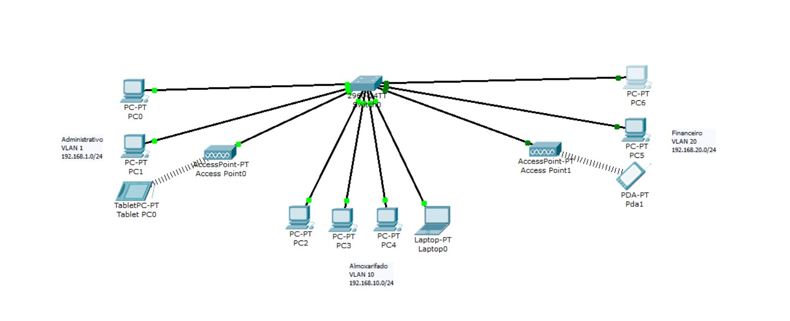

# EXERCÍCIO PRÁTICO

Criar um projeto que tenha uma vlan com os seguintes setores:

## Administrativo:

	- 2 micros e 1 tablet
	- portas 1 a 7

## Almoxarifado:

	- 3 micros e 1 notebook
	- portas 10 a 18

## Financeiro:

	- 2 micros, 1 smartphone
	- portas 20 a 24

