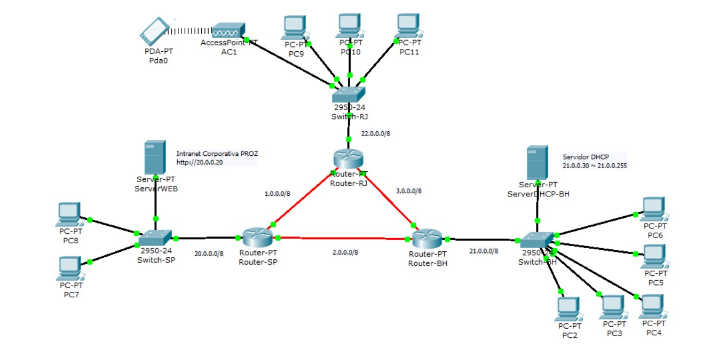

# EXERCÍCIO PRÁTICO

Criar um projeto com 3 redes de 3 cidades ligadas com roteadores.

## Cidades de cada rede

	- São Paulo
	- Rio de Janeiro
	- Belo Horizonte

Faça configurações dos hosts das redes utilizando IP classe A

